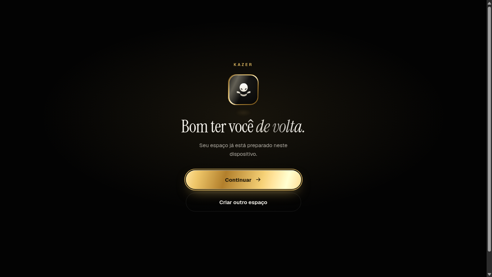
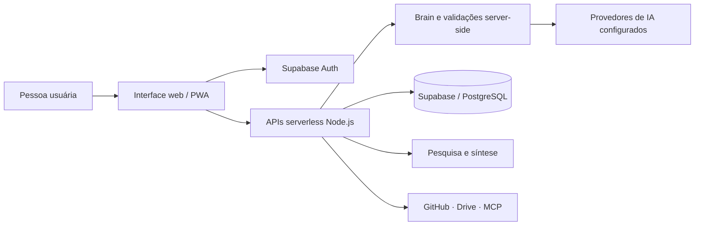

<p align="center">
  
</p>

<h1 align="center">KAZER</h1>

<p align="center">
  <strong>Conversa. Pesquisa. Workspace. Ateliê.</strong><br>
  Espaço pessoal em português · web/PWA · código proprietário · sem aluguel de GPU no plano livre
</p>

<p align="center">
  <a href="https://kazer.vercel.app"><strong>Abrir o produto</strong></a>
  ·
  <a href="planos/CATALOGO-FERRAMENTAS.md">Ferramentas</a>
  ·
  <a href="planos/ATELIE.md">Ateliê</a>
  ·
  <a href="planos/MONETIZACAO-ZERO.md">Caixa</a>
  ·
  <a href="planos/PESQUISA-2026-10-12.md">Bancada</a>
  ·
  <a href="planos/PESQUISA-2026-10-13.md">Balcão</a>
  ·
  <a href="planos/PESQUISA-2026-10-14.md">Mesa</a>
  ·
  <a href="planos/PESQUISA-2026-10-15.md">Gaveta</a>
  ·
  <a href="planos/PESQUISA-2026-10-16.md">Prensa</a>
  ·
  <a href="docs/project-guide.md">Guia</a>
  ·
  <a href="SECURITY.md">Segurança</a>
</p>

<p align="center">
  <a href="https://github.com/jeanvicen/KAZER/actions/workflows/ci.yml"></a>
  
  
  
  
</p>

---

## Conheça a interface

A imagem abaixo é uma captura pública da tela de boas-vindas/login do KAZER. **Não é uma captura do chat autenticado**; nenhum usuário estava conectado.

<p align="center">
  
</p>

## Já no ar

O produto publicado em [kazer.vercel.app](https://kazer.vercel.app) é o que o usuário usa hoje. Esta tabela descreve o que o código documenta — não o que um planejamento promete.

| Área | Situação documentada no código |
|---|---|
| **Chat com IA** | API server-side com roteamento do Brain entre provedores configurados, histórico de conversa enviado pelo cliente e renderização de respostas. |
| **Anexos** | Fluxo para imagens, PDF, DOCX e formatos de texto/código permitidos, com validação e limites no servidor. |
| **Pesquisa WebKazer** | Rota dedicada de pesquisa e síntese de fontes; a documentação distingue pesquisa pelo usuário e chamada pelo Brain. |
| **Workspace** | Cadastro e acompanhamento de tarefas, status/progresso, conectores MCP e repositórios; o repositório não documenta um executor geral dessas tarefas. |
| **Conectores** | Integrações com Google Drive, MCP remoto e GitHub OAuth. Segredos de conectores são tratados no backend. |
| **Conta e PWA** | Supabase Auth, interface web responsiva, manifesto e service worker para instalação como PWA. |
| **Planos** | A interface pode apresentar uma chamada para Kazer Pro; **compra e cobrança não estão implementadas**. |

> O estado das integrações depende das configurações externas e das migrações aplicadas. Uma rota ou interface no repositório não comprova por si só que serviços externos estão configurados ou testados em produção.

## O que entra ao lado

Nada disto apaga `interface/`, `api/` ou `database/`. Cada item nasce como módulo novo. Detalhe em [`planos/`](planos/README.md).

| Para o usuário | Por que pagam lá fora | Como o KAZER faz sem GPU |
|---|---|---|
| Selo e marca em SVG | Recraft Basic ~US$ 12 | Ateliê no browser |
| Brand kit + social | Canva Pro ~US$ 12–15 | Tokens CSS + 1:1 / 9:16 / 16:9 |
| Voz PT · JP | ElevenLabs (crédito) | Web Speech do aparelho |
| Proposta MEI | Freelancer R$ 80–200 | HTML imprimível + PIX |
| PIX do Pro | Cartão gringo + IOF | Abacate Pay R$ 0,80 / parcela |

Pesquisa de 7 de outubro de 2026: [`planos/PESQUISA-2026-10-07.md`](planos/PESQUISA-2026-10-07.md).

## Bancada de 9 de outubro

Pesquisa nova, sem apagar a de 6 e 7 de outubro. Tudo roda no navegador da pessoa. A casa não paga GPU e não hospeda o arquivo.

| Peça | Quem cobra lá fora | No KAZER |
|---|---|---|
| Juntar, separar, girar PDF | iLovePDF, cota e anúncio | `pdf-lib` (MIT), no aparelho |
| Comprimir foto e tirar paleta | TinyPNG, kit travado | Canvas, no aparelho |
| Recortar pessoa | remove.bg, por crédito | MediaPipe (Apache). Sem biblioteca AGPL |
| Deck 16:9 | Gamma ~US$ 9 | HTML do Brain + imprimir |
| Cartão / link na bio | Linktree Pro | Um HTML para baixar |
| Ler nota ou print | Adobe Scan | `tesseract.js` (Apache) |
| Resumo no Chrome de mesa | ChatGPT Plus | API nativa, se a máquina aguentar. Celular continua no Brain |

Licença, ordem de build e conta: [`planos/PESQUISA-2026-10-09.md`](planos/PESQUISA-2026-10-09.md).

## Bancada de 12 de outubro

Pesquisa nova. Não apaga as de 6, 7 e 9. Continua no aparelho. Continua sem GPU. Não está no ar.

| Peça | Quem cobra lá fora | No KAZER |
|---|---|---|
| Fundo, vitrine, cartaz de link | Placeit ~US$ 15/mês · API de imagem na casa dos US$ 49 / mil | SVG e moldura CSS, foto local |
| Ícone e contraste | Pacote de ícone · plugin de acessibilidade | Lucide (ISC / MIT) e WCAG no canvas |
| Carrossel e capa de story | Canva Pro | PNG no aparelho |
| QR e recibo da banca | Gerador com anúncio | Chave Pix **da pessoa**, no celular. Não é o caixa do Pro |
| Briefing de marca | Reunião com designer | O Brain que já existe devolve paleta e tom |

O grátis sai com o selo “feito no KAZER”. O Pro, quando a compra existir, tira o selo. Licença e ordem: [`planos/PESQUISA-2026-10-12.md`](planos/PESQUISA-2026-10-12.md).

## Balcão de 13 de outubro

Pesquisa nova. Não apaga as de 6, 7, 9 e 12. Continua no aparelho. Continua sem GPU. Não está no ar.

| Peça | Quem cobra lá fora | No KAZER |
|---|---|---|
| Etiqueta de gôndola | Sistema de etiqueta com mensalidade | JsBarcode (MIT), no aparelho. Não é nota fiscal |
| Cardápio de uma folha | Designer de cardápio | HTML para imprimir, PT ou PT · JP |
| Assinatura no papel | Por envelope | signature_pad (MIT). Não é certificado |
| Marca d'água em lote | App cobra para tirar o selo | Canvas. Grátis leva “feito no KAZER”. Pro leva o logo da pessoa |
| Story, figurinha, print | CapCut e captura paga | Vídeo nativo, quadrado 512, seta na foto. Sem FFmpeg |
| Wi-Fi da loja e cartão PT · JP | Gerador com anúncio · gráfica | QR no celular. A senha não sai do aparelho |
| Semana de posts | Agenda de social paga | O Brain que já existe devolve sete linhas |

O selo no grátis é o anúncio: a peça viaja no WhatsApp sem a casa pagar impulsionamento. Licença e ordem: [`planos/PESQUISA-2026-10-13.md`](planos/PESQUISA-2026-10-13.md).

## Mesa de 14 de outubro

Pesquisa nova. Não apaga as de 6, 7, 9, 12 e 13. Continua no aparelho. Continua sem GPU. Não está no ar.

| Peça | Quem cobra lá fora | No KAZER |
|---|---|---|
| Assinatura de e-mail | WiseStamp Pro+ a partir de US$ 9/mês | HTML de tabela. Cola no Gmail. Sem hospedar foto |
| Certificado de oficina | Modelo no Canva Pro | HTML para imprimir. Não é diploma |
| Rampa de cor | Exportação de sistema travada | culori (MIT), hex e OKLCH |
| Folha de gráfica | A arte sem sangria volta cobrada | SVG com marca de corte e 3 mm |
| Grade 3×3 | Planoly Starter US$ 14–16/mês | Nove fotos locais, um PNG. Não publica |
| Prancha | Milanote US$ 9,99/mês no anual | Fotos locais num quadro. Não sobe |
| Quanto cobrar | Planilha de precificação | Conta no celular. Não é o contador |
| Vale da banca | App de fidelidade com mensalidade | Papel com código local. Não é cupom fiscal |

O selo no grátis segue o anúncio: o e-mail e o certificado saem com o nome. Licença e ordem: [`planos/PESQUISA-2026-10-14.md`](planos/PESQUISA-2026-10-14.md).

## Gaveta de 15 de outubro

Pesquisa nova. Não apaga as de 6, 7, 9, 12, 13 e 14. Continua no aparelho. Continua sem GPU. Não está no ar.

| Peça | Quem cobra lá fora | No KAZER |
|---|---|---|
| HEIC → JPEG | Conversor que pede a foto | Canvas, se o navegador já abre. Sem libheif |
| Fotos → um PDF | Smallpdf e iLovePDF sobem o arquivo | `pdf-lib` (MIT). Não é juntar PDF com PDF |
| Cópia sem GPS | Site que pede a foto | exifr (MIT) só lê. Canvas grava JPEG limpo |
| Tarja de CPF | Tarja com upload | Retângulo no aparelho. Não é o anotador de print |
| Foto 3×4 | App cobra R$ 4,90 para tirar o selo | Guia e folha 10×15. Não é o órgão |
| Cartão .vcf | HiHello ~US$ 6/mês no anual | Texto + PNG. Sem hospedar perfil |
| Cartaz de avaliação | Gerador com anúncio | Link que a pessoa cola. Papel de balcão |
| Obrigado do pedido | Modelo no Canva Pro | Cartão pequeno para o pacote. Não é nota |

Documento sai sem selo. Peça de parede leva “feito no KAZER” no grátis. Licença e ordem: [`planos/PESQUISA-2026-10-15.md`](planos/PESQUISA-2026-10-15.md).

## Prensa de 16 de outubro

Pesquisa nova. Não apaga as de 6, 7, 9, 12, 13, 14 e 15. Continua no aparelho. Continua sem GPU. Não está no ar.

| Peça | Quem cobra lá fora | No KAZER |
|---|---|---|
| Logo chapado → SVG | Vector Magic cobra e o arquivo sobe | ImageTracerJS 1.2.6 (Unlicense). Não é foto |
| Branco → transparente | Editor pede o arquivo | Canvas. Não é o recorte de pessoa |
| Duotone | Duas tintas travadas no Canva Pro | Canvas. Não é a rampa OKLCH |
| DPI da gráfica | A reimpressão | px e cm. Não é a folha de sangria |
| Caixa simples | Pacdora: o grátis não tira a marca | SVG em milímetro. A gráfica confere |
| Conta da vitrine | Planilha de taxa | A pessoa digita a % do painel |
| Cartaz DE/POR | Modelo no Canva Pro | HTML de gôndola. Não é a etiqueta |
| Monograma | Gerador de favicon pede upload | PNG 16–512. Não é o selo da casa |

Número na tela sai sem selo. Peça que viaja leva “feito no KAZER” no grátis. No logo, a linha fica fora da marca. Licença e ordem: [`planos/PESQUISA-2026-10-16.md`](planos/PESQUISA-2026-10-16.md).

## Como a casa ganha sem gastar para abrir

Infra livre enquanto couber nos planos Hobby: Vercel, Supabase, Groq, Hugging Face, GitHub, Web Speech, SVG no cliente.

| Assinantes | Preço | Bruto / mês | Infra |
|---:|---:|---:|---:|
| 40 | R$ 29 | R$ 1.160 | R$ 0 |
| 100 | R$ 29 | R$ 2.900 | R$ 0 |
| 40 | R$ 79 | R$ 3.160 | R$ 0 |

Taxa só na venda. Cadastro do gateway é grátis. Conferido em 14/10 e de novo em 15/10: Pix da Abacate segue R$ 0,80, sem mensalidade. Contas em [`planos/MONETIZACAO-ZERO.md`](planos/MONETIZACAO-ZERO.md).

## Como o KAZER funciona

A interface web autentica com Supabase Auth e chama funções Node.js em `api/`. Os handlers conferem a sessão e validam as entradas no servidor antes de acessar o banco, os provedores de IA ou os conectores configurados. A interface PWA e as APIs são partes distintas; configuração de uma integração não é presumida pelo README.

## Arquitetura em uma visão



As rotas serverless validam a sessão e os dados no servidor. O navegador usa a chave publicável do Supabase quando necessário; chaves privadas e tokens de provedores devem permanecer no ambiente de servidor. Consulte [Segurança](SECURITY.md) para limites e pendências que não são resolvidos apenas pela arquitetura.

<details>
<summary><strong>Começar a executar verificações localmente</strong></summary>

Requisitos: Node.js 20 ou superior (versão declarada em `.nvmrc`) e npm.

```bash
git clone https://github.com/jeanvicen/KAZER.git
cd KAZER
npm ci --ignore-scripts
npm test
npm run check
npm run integration:test
npm run security:audit -- --audit-level=high
```

Os smoke tests de integração fazem stubs de respostas externas; eles validam contratos locais e **não** substituem testes reais com duas contas, GitHub OAuth em WebView, MCPs de terceiros ou verificação de produção. Leia o [guia de testes](docs/testing.md). O `.env.example` é apenas uma referência; use credenciais próprias de desenvolvimento e nunca publique `.env`.

</details>

<details>
<summary><strong>Estrutura principal</strong></summary>

| Caminho | Conteúdo |
|---|---|
| `interface/` | Páginas estáticas e scripts/CSS do navegador. |
| `api/` | Rotas Vercel e módulos internos do backend. |
| `database/supabase/` | Migrações incrementais e documentação do banco. |
| `download/` | URLs públicas: manifesto, service worker, ícones, APK e assets. |
| `mobile/` | App Expo/WebView independente, com pacote e lockfile próprios. |
| `worker/` | Processo separado para tarefas em segundo plano. |
| `skills/` | Skills e referências carregadas pelo Brain no servidor. |
| `scripts/` e `test/` | Verificações, smoke tests e regressões. |
| `docs/` | Guias técnicos, arquitetura, testes, políticas e auditorias. |
| `planos/` | Catálogo, ateliê, caixa e pesquisa — ao lado do produto, nunca no lugar. |
| `Control/` | Configuração e instruções de avisos globais. |
| `.github/`, `.well-known/` | CI e associação do app Android. |
| [`Mapa completo`](docs/repository-structure.md) | Responsabilidades de cada pasta e caminhos que não devem ser movidos sem validação. |

</details>

## Navegação

- [Guia técnico do projeto](docs/project-guide.md)
- [Arquitetura e mapa do repositório](docs/architecture.md) · [mapa detalhado de pastas](docs/repository-structure.md)
- [Índice da documentação](docs/README.md)
- [Arquitetura de pesquisa](docs/RESEARCH-ARCHITECTURE.md)
- [Tarefas em segundo plano (proposta)](docs/background-tasks.md)
- [Configuração de ambiente](docs/configuration.md) e [`.env.example`](.env.example)
- [Migrações e compatibilidade Supabase](database/supabase/README.md)
- [Testes e limitações de validação](docs/testing.md)
- [Auditoria de segurança e riscos pendentes](SECURITY.md)
- [Roadmap / ateliê / caixa](planos/README.md)
- [Bancada de 9 de outubro](planos/PESQUISA-2026-10-09.md)
- [Bancada de 12 de outubro](planos/PESQUISA-2026-10-12.md)
- [Balcão de 13 de outubro](planos/PESQUISA-2026-10-13.md)
- [Mesa de 14 de outubro](planos/PESQUISA-2026-10-14.md)
- [Gaveta de 15 de outubro](planos/PESQUISA-2026-10-15.md)
- [Prensa de 16 de outubro](planos/PESQUISA-2026-10-16.md)

## Capacidades de agente no Brain

O Brain agora seleciona e carrega no servidor as Skills `kazer-research`,
`kazer-code`, `kazer-security`, `kazer-docs`, `kazer-growth` e
`kazer-design-system` conforme a intenção detectada. Cada Skill e suas
referências permitidas ficam versionadas em `skills/`; a função de chat inclui
esses arquivos no pacote de produção da Vercel. O cliente não escolhe um slug
de Skill nem envia permissões para o servidor.

As permissões do frontmatter são comparadas com uma lista confiável no servidor.
Elas descrevem o escopo da Skill, mas **não concedem acesso por si só**: uma
ferramenta só fica disponível quando o Brain a registra e a política do servidor
a autoriza. A ferramenta `research_web` continua limitada a tarefas que precisam
de pesquisa e exige `web.read` e `net.fetch`; ferramentas MCP continuam dependendo
de conectores explicitamente selecionados e carregados após autenticação.

### Limites atuais

- A seleção de Skills e a inclusão de instruções/referências no Brain estão
  implementadas e cobertas por testes. O Brain existente continua usando a
  pesquisa autorizada e os conectores MCP já disponíveis, sem alterar a interface.
- `terminal_exec` só é registrado numa solicitação interativa quando há um
  repositório GitHub selecionado e validado, a conexão GitHub do usuário permite
  lê-lo, `E2B_API_KEY` está configurada no servidor e a Skill ativa declara
  `shell.exec` e `code.run`. Sem qualquer uma dessas condições, a ferramenta não
  fica disponível.
- Para executar um comando, o servidor copia para um sandbox E2B temporário
  apenas arquivos de texto de extensões permitidas do branch padrão; arquivos de
  segredo, binários e diretórios como `.env`, `.git`, `node_modules`, `dist` e
  `build` são excluídos, e padrões conhecidos de chaves são redigidos. O código
  selecionado é transmitido ao E2B para essa execução. O sandbox não recebe
  credenciais do KAZER, não tem acesso de saída à internet, tem limite de 20 s por
  comando e é encerrado ao final. Há no máximo uma execução por solicitação. Como
  não há acesso de rede nem instalação de dependências, testes que dependam de
  pacotes ausentes podem não ser executáveis nesse sandbox.
- O terminal é efêmero e somente de validação: não grava de volta no GitHub nem no
  servidor KAZER, não faz commit/deploy/publicação e não cria artefatos
  persistentes. `files.write` continua sendo apenas uma declaração de Skill,
  ainda sem armazenamento de arquivos ligado a ela. O Brain deve informar esses
  limites e nunca alegar alterações ou validações sem resultado confirmado.
- O runtime mantém os limites existentes do orquestrador (até cinco rodadas de
  tool calling e seis chamadas por rodada); comandos e saída também têm limites
  próprios no executor.

As telas, o logotipo, os arquivos de interface e o deploy publicado permanecem
inalterados. Para habilitar o terminal no deploy, configure `E2B_API_KEY` como
variável de ambiente do servidor; sem ela, nenhum código é enviado ao E2B.
**O código-fonte escolhido é enviado ao E2B quando o executor é usado.**

## Status e propriedade

O KAZER continua em desenvolvimento. Funcionalidades disponíveis dependem do deploy e da configuração dos provedores; itens de planejamento não devem ser interpretados como recursos ativos. Não há checkout Kazer Pro neste estado do produto. Consulte [`LICENSE.md`](LICENSE.md) para os termos de uso do código e dos ativos.

**Regra da casa:** melhorar sempre. Nunca destruir. Nunca trocar o que já funciona por moda.
