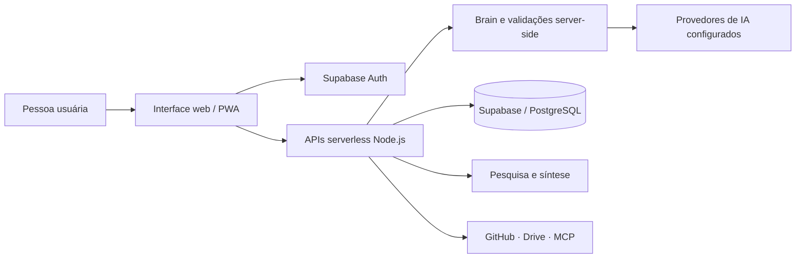

<p align="center">
  
</p>

<h1 align="center">KAZER</h1>

<p align="center">
  <strong>Seu espaço pessoal para conversar, pesquisar e organizar ideias.</strong><br>
  Aplicação web/PWA em desenvolvimento · interface em português · código proprietário
</p>

<p align="center">
  <a href="https://kazer.vercel.app">Abrir o produto</a> ·
  <a href="docs/project-guide.md">Guia do projeto</a> ·
  <a href="SECURITY.md">Segurança</a> ·
  <a href="docs/testing.md">Testes</a>
</p>

<p align="center">
  <a href="https://github.com/jeanvicen/KAZER/actions/workflows/ci.yml"></a>
  
  
</p>

---

## Conheça a interface

A imagem abaixo é uma captura pública da tela de boas-vindas/login do KAZER. **Não é uma captura do chat autenticado**; nenhum usuário estava conectado.

<p align="center">
  
</p>

## O que existe no repositório

| Área | Situação documentada no código |
|---|---|
| **Chat com IA** | API server-side com roteamento do Brain entre provedores configurados, histórico de conversa enviado pelo cliente e renderização de respostas. |
| **Anexos** | Fluxo para imagens, PDF, DOCX e formatos de texto/código permitidos, com validação e limites no servidor. |
| **Pesquisa WebKazer** | Rota dedicada de pesquisa e síntese de fontes; a documentação distingue pesquisa pelo usuário e chamada pelo Brain. |
| **Workspace** | Cadastro e acompanhamento de tarefas, status/progresso, conectores MCP e repositórios; o repositório não documenta um executor geral dessas tarefas. |
| **Conectores** | Integrações com Google Drive, MCP remoto e GitHub OAuth. Segredos de conectores são tratados no backend. |
| **Conta e PWA** | Supabase Auth, interface web responsiva, manifesto e service worker para instalação como PWA. |
| **Planos** | A interface pode apresentar uma chamada para Kazer Pro; **compra e cobrança não estão implementadas**. |

> O estado das integrações depende das configurações externas e das migrações aplicadas. Uma rota ou interface no repositório não comprova por si só que serviços externos estão configurados ou testados em produção.

## Como o KAZER funciona

A interface web autentica com Supabase Auth e chama funções Node.js em `api/`. Os handlers conferem a sessão e validam as entradas no servidor antes de acessar o banco, os provedores de IA ou os conectores configurados. A interface PWA e as APIs são partes distintas; configuração de uma integração não é presumida pelo README.

## Arquitetura em uma visão



As rotas serverless validam a sessão e os dados no servidor. O navegador usa a chave publicável do Supabase quando necessário; chaves privadas e tokens de provedores devem permanecer no ambiente de servidor. Consulte [Segurança](SECURITY.md) para limites e pendências que não são resolvidos apenas pela arquitetura.

<details>
<summary><strong>Começar a executar verificações localmente</strong></summary>

Requisitos: Node.js 20 ou superior (versão declarada em `.nvmrc`) e npm.

```bash
git clone https://github.com/jeanvicen/KAZER.git
cd KAZER
npm ci --ignore-scripts
npm test
npm run check
npm run integration:test
npm run security:audit -- --audit-level=high
```

Os smoke tests de integração fazem stubs de respostas externas; eles validam contratos locais e **não** substituem testes reais com duas contas, GitHub OAuth em WebView, MCPs de terceiros ou verificação de produção. Leia o [guia de testes](docs/testing.md). O `.env.example` é apenas uma referência; use credenciais próprias de desenvolvimento e nunca publique `.env`.

</details>

<details>
<summary><strong>Estrutura principal</strong></summary>

| Caminho | Conteúdo |
|---|---|
| `interface/` | Login, chat e páginas públicas. |
| `api/` | Funções serverless para chat, pesquisa, uso, workspace e integrações. |
| `database/supabase/` | Migrações incrementais e documentação do banco. |
| `download/` | Manifesto, service worker, ícones e assets oficiais. |
| `mobile/` | Projeto Expo/EAS que abre a experiência publicada. |
| `docs/` | Guias técnicos, arquitetura, testes e auditorias. |
| `.github/workflows/` | Verificações automáticas do CI. |

</details>

## Navegação

- [Guia técnico do projeto](docs/project-guide.md)
- [Índice da documentação](docs/README.md)
- [Arquitetura de pesquisa](docs/RESEARCH-ARCHITECTURE.md)
- [Configuração de ambiente](docs/configuration.md) e [`.env.example`](.env.example)
- [Migrações e compatibilidade Supabase](database/supabase/README.md)
- [Testes e limitações de validação](docs/testing.md)
- [Auditoria de segurança e riscos pendentes](SECURITY.md)
- [Roadmap/documentação de planos](planos/README.md)

## Status e propriedade

O KAZER continua em desenvolvimento. Funcionalidades disponíveis dependem do deploy e da configuração dos provedores; itens de planejamento não devem ser interpretados como recursos ativos. Não há checkout Kazer Pro neste estado do produto. Consulte [`LICENSE.md`](LICENSE.md) para os termos de uso do código e dos ativos.

