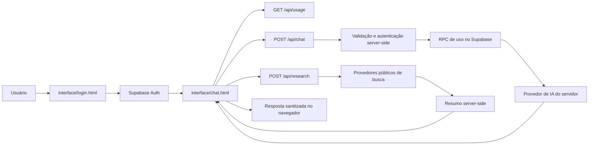

# KAZER

> **KAZER** é um espaço web/PWA de conversa com inteligência artificial para explicar, escrever, organizar ideias, analisar conteúdo e transformar pedidos em próximos passos.
>
> **Titularidade declarada no projeto:** Jean V. / `@jeanvicen` · identidade pública `0neajx` · KLYPZA. Substitua esta identificação pelos dados legais completos do titular antes de uma publicação comercial ou de um aviso jurídico definitivo.

[](#status-do-projeto) [](#requisitos) [](#publicação-na-vercel)

## Visão rápida da versão atual

Este guia descreve a organização observada na branch `main` em 18 de outubro de 2026. Ele não comprova deploy, configurações externas, execução das migrações ou isolamento real em produção. O navegador mantém a sessão e parte do histórico; APIs privadas validam a sessão no servidor.

| Área | Estado observado no código |
|---|---|
| Histórico | Até 10 conversas por usuário no `localStorage` deste navegador/dispositivo, com até 72 mensagens por conversa; não há sincronização de histórico entre dispositivos demonstrada. |
| Anexos | Imagens, PDF, DOCX e tipos de texto/código permitidos passam por validações e limites no backend. |
| Uso | Há rotas/RPCs para consultar e consumir uso; a compatibilidade depende da versão do schema Supabase aplicado. |
| Workspace | A API registra tarefas/progresso e integrações. O chat também pode oferecer execução efêmera em sandbox isolado quando um repositório foi validado e o E2B está configurado; isso não equivale a um executor persistente de tarefas. |
| Qualidade | O CI em `.github/workflows/ci.yml` inclui suíte unitária, verificações, smoke tests e auditoria npm; consulte o run do commit específico. |

> **Nota de segurança:** um repositório público pode ser clonado. Para impedir acesso ao código, é necessário mantê-lo privado e restringir colaboradores; documentação e avisos autorais não substituem controles de acesso.

## Aviso de propriedade e uso

Este repositório contém código, interface, textos, identidade visual, fluxos, regras de produto, configurações e materiais do KAZER. **O projeto não é open source e não concede autorização geral para copiar, modificar, redistribuir, vender, sublicenciar, publicar forks, remover avisos, reutilizar a marca ou criar um serviço derivado.** A simples disponibilidade do repositório no GitHub não deve ser interpretada como uma licença de reutilização; o GitHub recomenda que o projeto declare expressamente a licença e observa que, sem licença, aplicam-se os direitos autorais padrão.[1]

A proteção de software no Brasil é tratada pela legislação de propriedade intelectual e direitos autorais, e a proteção independe de registro segundo a Lei nº 9.609/1998.[2] Este aviso é uma medida documental e contratual; **nenhum texto impede tecnicamente que alguém faça download, cópia ou fork de um repositório público**. Se o objetivo for impedir acesso ao código-fonte, mantenha o repositório privado e publique apenas uma demonstração ou documentação autorizada. Ao mudar um repositório público para privado, forks públicos existentes podem continuar públicos e ser separados da rede original.[3]

As regras completas estão em [`LICENSE.md`](../LICENSE.md), [`TERMOS-DE-USO.md`](TERMOS-DE-USO.md), [`AVISO-DE-DIREITOS-AUTORAIS.md`](AVISO-DE-DIREITOS-AUTORAIS.md) e [`CONTRIBUTING.md`](../CONTRIBUTING.md). Os textos jurídicos são **rascunhos para revisão de advogado**, especialmente quanto à identificação do titular, jurisdição, consumidor, privacidade, notificações e exploração comercial.

## Sumário

- [Visão geral](#visão-geral)
- [Como o KAZER funciona](#como-o-kazer-funciona)
- [Recursos disponíveis](#recursos-disponíveis)
- [Arquitetura](#arquitetura)
- [Estrutura do repositório](#estrutura-do-repositório)
- [Requisitos](#requisitos)
- [Configuração rápida](#configuração-rápida)
- [Variáveis de ambiente](#variáveis-de-ambiente)
- [Banco Supabase](#banco-supabase)
- [Publicação na Vercel](#publicação-na-vercel)
- [Desenvolvimento local](#desenvolvimento-local)
- [Contratos das APIs](#contratos-das-apis)
- [Segurança](#segurança)
- [Privacidade e retenção](#privacidade-e-retenção)
- [Limites atuais](#limites-atuais)
- [PWA e distribuição móvel](#pwa-e-distribuição-móvel)
- [Verificações](#verificações)
- [Documentos e autoria](#documentos-e-autoria)
- [Status do projeto](#status-do-projeto)
- [Contribuições](#contribuições)
- [Licença](#licença)
- [Referências](#referências)

## Visão geral

O KAZER é uma aplicação estática preparada para Vercel, com páginas HTML/CSS/JavaScript em `interface/`, rotas serverless Node.js em `api/`, implementações backend por domínio em `server/` e recursos de autenticação, preferências, avisos, uso e retenção apoiados pelo Supabase. As migrações definem RLS, mas produção não foi inspecionada dinamicamente. O processamento de chat usa um Brain server-side com entendimento de intenção, plano interno de capacidades, instruções modulares, roteamento previsível e fallback explícito de modelos/providers; a pesquisa do WebKazer consulta múltiplos provedores públicos, lê fontes em segundo plano e usa o mesmo Brain para sintetizar evidências.

A interface pode funcionar como site responsivo e como PWA instalável. O fluxo de conta usa Supabase Auth, a sessão é mantida no navegador e as rotas privadas exigem o bearer token da sessão. O histórico de conversas é salvo no `localStorage` por usuário neste navegador/dispositivo (até 10 conversas e 72 mensagens por conversa no código revisado); não é uma cópia persistente no banco nem sincroniza entre dispositivos. O **Nova conversa** inicia outro registro local.

> **Importante:** respostas geradas por IA podem conter erros, omissões ou interpretações incompletas. O KAZER não substitui orientação médica, jurídica, financeira, profissional, atendimento de emergência ou julgamento humano responsável.

## Como o KAZER funciona

O fluxo principal segue quatro etapas. Primeiro, a pessoa cria uma conta ou entra pelo Supabase Auth. Depois, a tela `interface/chat.html` recupera a sessão, carrega o perfil e as preferências e consulta o uso disponível. Ao enviar uma mensagem, o navegador envia apenas o histórico permitido e os anexos selecionados para `POST /api/chat`, sempre com autenticação. A API valida origem, sessão, tamanho, conteúdo, anexos, moderação e limites de uso; seleciona contexto relacionado e histórico recente; cria um plano interno de intenção, restrições e capacidades; monta apenas os módulos de instrução necessários; e disponibiliza pesquisa ou MCP somente quando aplicável. Por fim, a resposta é sanitizada e renderizada na interface.

O WebKazer usa o Research Orchestrator. A pessoa abre **Perfil → Mais opções → WebKazer**, escolhe o modo de pesquisa e envia uma consulta para `POST /api/research`. O Brain também pode chamar `research_web` no chat quando a pergunta exige pesquisa. O modo profundo gera até 12 consultas facetadas em paralelo, reúne até 120 candidatos, seleciona fontes relevantes, abre páginas com Browser Agent/Chromium quando disponível, usa fallback HTTP, extrai evidências, aplica limites de segurança e devolve somente uma síntese final com citações. Consulte [docs/RESEARCH-ARCHITECTURE.md](RESEARCH-ARCHITECTURE.md) para o fluxo, deploy e limitações.



## Recursos disponíveis

| Recurso | O que faz | Onde está implementado |
|---|---|---|
| Conta | Cadastro, login, sessão persistente, logout e perfil básico. | `interface/login.html`, Supabase Auth e `profiles`. |
| Chat | Conversa com histórico da página, respostas em Markdown simples e geração progressiva visual. | `interface/chat.html` e `api/chat.js`. |
| Imagens | Envio de JPEG, PNG, WebP e GIF para análise visual, dentro dos limites da conta. | `interface/chat.html` e `api/chat.js`. |
| Arquivos | Leitura limitada de PDF, DOCX e arquivos de texto/código compatíveis. | `api/chat.js`, `pdf-parse` e `mammoth`. |
| Research Orchestrator | Pesquisa multietapas, Browser Agent, evidências e citações. | `api/research.js`, `server/research/_research-orchestrator.js` e `server/research/_research-browser.js`. |
| Preferências | Tema, idioma, avisos e aviso de instalação, com fallback local e sincronização no perfil. | `user_settings` e `localStorage`. |
| Retenção | Avisos de inatividade e job diário de retenção, com exclusão desligada por padrão. | `api/retention.js`, `vercel.json` e migrações Supabase. |
| PWA | Instalação na tela inicial, manifesto, service worker e cache restrito do app shell. | `download/manifest.webmanifest`, `download/sw.js` e `vercel.json`. |
| Plugins | Google Drive e gerenciamento de conexões MCP; o runtime executa MCP remoto. Valores `command` de MCP local não foram executados nesta revisão. | `interface/chat.html`, `interface/kazer-workspace.js`, rewrite `/api/mcp` para `api/workspace.js`, `server/integrations/_mcp-runtime.js` e migração `010`. |
| GitHub | OAuth para vincular a conta, listar/buscar repositórios e usar um repositório como contexto do pedido. | `api/github.js` (com rewrites de compatibilidade em `vercel.json`), `interface/kazer-workspace.js` e `kazer_github_connections`. |
| Workspace | Interface/API para registrar tarefas, status/progresso, conectores e repositórios. O terminal opcional do Brain é efêmero e não grava resultados de volta no GitHub; não mostrar custo de tarefa: a coluna `credit_cost` foi removida do schema atual. | `interface/chat.html`, `interface/kazer-workspace.js`, `api/workspace.js`, `server/tasks/_tasks-handler.js` e `kazer_tasks`. |
| Kazer Pro | Chamada visual de oferta; a tela informa que a página de compra está em preparação. | `interface/chat.html`. |

## Arquitetura

A aplicação é deliberadamente dividida entre um cliente estático e funções serverless. O navegador pode conter somente a URL do Supabase e a chave pública `anon`/publishable; chaves de provedores de IA, `service_role` e segredo do cron devem ficar nas variáveis privadas da Vercel. O cliente nunca deve ser tratado como fonte de verdade para identidade, créditos, anexos ou autorização.

| Camada | Responsabilidade | Regra de proteção |
|---|---|---|
| Navegador | Exibir a interface, manter sessão do Supabase, montar requisições e renderizar respostas. | Nunca armazenar ou enviar chaves privadas; escapar conteúdo antes de inserir no DOM. |
| `api/` | Rotas HTTP serverless Vercel: autenticar bearer token, validar entrada e devolver JSON. | Preservar URLs e contratos; manter apenas handlers de rota e não colocar segredos no cliente. |
| `server/` | Implementações internas por domínio, usadas pelas rotas e pelo worker. | Lógica única, validação server-side, dependências explícitas e testes de regressão. |
| Supabase Auth | Cadastro, login, renovação e revogação da sessão. | Usar somente o fluxo oficial; não gravar senhas em tabelas próprias. |
| PostgreSQL/Supabase | Perfis, preferências, avisos, tarefas, integrações e dados de uso conforme o schema aplicado. | Migrações declaram políticas e RPCs; RLS efetivo em produção e isolamento cross-account ainda precisam de validação. |
| Vercel | Hospedagem estática, funções serverless, headers e cron diário. | Variáveis secretas privadas, HTTPS, CSP, HSTS e revisão de logs. |
| Provedores externos | Resposta de IA, visão, busca e resumo, conforme recurso utilizado. | Enviar somente o necessário, usar HTTPS, timeout e limites; não enviar segredos desnecessários. |

## Estrutura do repositório

| Caminho | Conteúdo |
|---|---|
| `interface/` | Páginas web estáticas e scripts/CSS do navegador. |
| `api/` | Handlers HTTP serverless do deploy Vercel; chat, pesquisa, uso, retenção, MCP, tarefas e integrações. A lógica compartilhada reside em `server/`. |
| `server/` | Implementações backend agrupadas por domínio: agente, integrações, pesquisa, segurança, armazenamento, tarefas e uso. |
| `database/supabase/` | Migrações SQL incrementais e instruções do banco. |
| `download/` | URLs públicas de manifesto, service worker, ícones, APK e materiais PWA/Android/iOS. |
| `mobile/` | App Expo/WebView com `package.json` e lockfile independentes da raiz. |
| `worker/` | Processo, inicialização e Dockerfile para tarefas em segundo plano. |
| `skills/` | Skills e referências carregadas pelo Brain no servidor. |
| `scripts/` | Verificações, testes de integração e manutenção. |
| `test/` | Testes automatizados de regressão e compatibilidade. |
| `docs/` | Arquitetura, guias, configuração, testes, políticas e auditorias. |
| `planos/` | Pesquisa e planejamento de produto; históricos são preservados. |
| `Control/` | Instruções e configuração de avisos globais. |
| `.github/` | CI, Dependabot e CODEOWNERS. |
| `.well-known/` | Associação pública do app Android. |
| `vercel.json` | Rewrites, headers, cron e inclusão de arquivos usados por funções. |
| `.env.example` | Nomes e valores de exemplo; nunca contém credenciais reais. |
| `package.json` | Dependências e scripts Node da raiz; o app móvel mantém pacote próprio. |
| [`repository-structure.md`](repository-structure.md) | Mapa detalhado e contratos de caminho que devem ser preservados. |

## Requisitos

Para executar o projeto é necessário Node.js 20 ou superior, npm, uma conta/projeto Supabase, um projeto Vercel para as funções serverless e credenciais válidas dos provedores habilitados. O Git e o GitHub CLI são recomendados para o fluxo de desenvolvimento, mas não são necessários para servir a interface estática.

O Supabase precisa estar configurado com Auth por e-mail e com a confirmação de e-mail compatível com a política do produto. A chave `anon` é publicável pela arquitetura atual, mas isso **não** substitui RLS. A chave `SUPABASE_SERVICE_ROLE_KEY` nunca deve ser colocada em HTML, JavaScript do navegador, logs, issues ou documentação pública.

## Configuração rápida

Clone o repositório, instale as dependências sem executar scripts de terceiros e copie o arquivo de ambiente de exemplo:

```bash
git clone https://github.com/jeanvicenc4/KAZER.git
cd KAZER
npm ci --ignore-scripts
cp .env.example .env
```

Preencha `.env` somente para o ambiente local. Para a aplicação completa, aplique as migrações Supabase na ordem indicada na seção seguinte, configure as variáveis na Vercel e execute as verificações:

```bash
npm run security:check
npm run security:audit -- --audit-level=high
```

Não faça commit de `.env`. O `.gitignore` já ignora arquivos de ambiente, `node_modules/`, artefatos da Vercel e arquivos locais de notas.

## Variáveis de ambiente

| Variável | Onde usar | Obrigatória | Finalidade |
|---|---|---:|---|
| `GROQ_API_KEY` | Servidor | Não | Habilita o provider Groq para chat/visão. |
| `HF_TOKEN` | Servidor | Não | Habilita o provider Hugging Face. |
| `KAZER_PROVIDER_ORDER` | Servidor | Não | Ordem determinística, por exemplo `groq,huggingface`; não é escolhida apenas pela existência de token. |
| `GROQ_MODEL` | Servidor | Não | Modelo de texto; há um padrão no código. |
| `GROQ_VISION_MODEL` | Servidor | Não | Modelo principal para imagens. |
| `GROQ_VISION_FALLBACK_MODEL` | Servidor | Não | Modelo de fallback para imagens. |
| `GROQ_REASONING_EFFORT` | Servidor | Não | Nível de raciocínio aceito pelo provider Groq. |
| `SUPABASE_URL` | Servidor | Sim | URL do projeto Supabase. |
| `SUPABASE_ANON_KEY` | Servidor/configuração pública | Sim | Chave pública de baixo privilégio; RLS continua obrigatório. |
| `SUPABASE_SERVICE_ROLE_KEY` | Servidor privado | Sim para MCPs, tarefas e GitHub | Chave administrativa; nunca exponha ao navegador. `SUPABASE_KEY` pode ser usada apenas como fallback privado no ambiente controlado. |
| `GITHUB_CLIENT_ID` | Servidor privado | Sim para conectar GitHub | Client ID do OAuth App do GitHub. |
| `GITHUB_CLIENT_SECRET` | Servidor privado | Sim para conectar GitHub | Segredo do OAuth App do GitHub. |
| `GITHUB_OAUTH_STATE_SECRET` | Servidor privado | Recomendado | Segredo longo para assinar o estado do OAuth. |
| `KAZER_CONNECTOR_ENCRYPTION_KEY` | Servidor privado | Obrigatória em produção | Chave aleatória longa para cifrar tokens/segredos de conectores; o código recusa ausência ou menos de 32 caracteres em `NODE_ENV=production`. Em ambiente não produtivo pode derivar do service role. |
| `E2B_API_KEY` | Servidor privado | Não | Habilita terminal efêmero; o código selecionado é enviado ao E2B, sem credenciais do KAZER e sem rede de saída no sandbox. |
| `CRON_SECRET` | Servidor privado | Só para retenção | Segredo para autorizar chamadas ao job `/api/retention`. |
| `PUBLIC_APP_ORIGINS` | Servidor | Recomendado | Lista separada por vírgulas das origens HTTPS autorizadas, sem barra final. |
| `RETENTION_DELETE_ENABLED` | Servidor | Sim | Mantenha `false`; somente um procedimento revisado pode habilitar exclusões permanentes. |

### Brain e providers

O padrão é `groq,huggingface`: se ambos estiverem configurados, Groq é tentado primeiro; se somente Hugging Face estiver configurado, ele é usado sem downgrade adicional. A ordem pode ser alterada por `KAZER_PROVIDER_ORDER`, e uma preferência explícita de uma operação (como a síntese de pesquisa) tem prioridade. Cada provider possui modelo principal e fallback por texto/visão. Timeout, rate limit, erro do provider, modelo indisponível ou resposta inválida podem avançar a fila; o motivo é registrado internamente sem secrets. Consulte [`brain.md`](brain.md) e [`configuration.md`](configuration.md).

As variáveis devem ser cadastradas na Vercel por ambiente, sem colar segredos em logs ou comandos compartilhados. Em produção, confirme que `PUBLIC_APP_ORIGINS` corresponde exatamente ao domínio HTTPS utilizado.

## Banco Supabase

As migrações versionadas não são uma baseline autossuficiente comprovada para banco vazio. Em particular, `016_security_rls_rpc_cleanup.sql` depende de objetos legados (`plan_catalog`, `user_usage` e RPCs anteriores) ausentes nas migrações anteriores atualmente versionadas. A migração `020_monthly_usage_percentage.sql` introduz a RPC de uso mensal atual; `021_security_function_search_path.sql` endurece `search_path` de funções.

As migrações corretivas `018` e `019` podem remover estruturas/dados antigos. Não pule, reordene ou aplique scripts em produção para “fazer passar” sem aprovação e plano. Consulte [`database/supabase/README.md`](../database/supabase/README.md), confira o histórico/schema do ambiente e teste um caminho de upgrade/instalação limpa isoladamente. O estado das políticas no repositório não substitui teste com duas contas.

## Publicação na Vercel

O projeto foi estruturado para ser publicado na Vercel a partir da raiz do repositório. No painel da Vercel, importe o repositório, mantenha as funções em `api/`, configure as variáveis de ambiente privadas e publique a branch `main`. O arquivo `vercel.json` cria os caminhos amigáveis `/login`, `/chat` e `/documentos`, expõe o manifesto e o service worker e agenda `/api/retention` diariamente às **04:00 UTC**.

Depois do deploy, valide o domínio real em HTTPS. A configuração já inclui CSP, HSTS, `X-Frame-Options: DENY`, `X-Content-Type-Options: nosniff`, `Referrer-Policy`, `Permissions-Policy`, isolamento de origem, `X-Robots-Tag` nas APIs e respostas sem cache. Ainda assim, o domínio deve ser testado com ferramentas de headers e com duas contas de teste.

> **Retenção:** deixe `RETENTION_DELETE_ENABLED=false`. Com a flag desligada, o job não deve apagar contas. A exclusão administrativa é permanente e exige revisão operacional independente.

## Desenvolvimento local

Para visualizar apenas as páginas estáticas, use um servidor local que não faça fallback de segurança para as APIs:

```bash
python3 -m http.server 4173
```

Abra `http://localhost:4173/interface/login.html`. Essa forma é útil para revisar layout, acessibilidade e navegação, mas **não simula as funções `/api/*` da Vercel**. Para testar o fluxo completo, use a CLI da Vercel e um ambiente Supabase de desenvolvimento:

```bash
npx vercel@latest dev
```

A CLI pode solicitar autenticação e configuração do projeto. Não use credenciais de produção em testes destrutivos, não execute a rotina de retenção com `RETENTION_DELETE_ENABLED=true` localmente e não compartilhe o terminal com variáveis secretas visíveis.

## Contratos das APIs

Todas as APIs privadas devem ser chamadas com `Authorization: Bearer <access_token>` obtido da sessão Supabase. Os endpoints recusam métodos inadequados, origens não permitidas e solicitações que excedam os limites definidos.

| Endpoint | Método | Entrada principal | Saída/erros relevantes |
|---|---|---|---|
| `/api/chat` | `POST` | `{ messages, attachments, mcpConnectorIds }` | `message`, `usage`, `credit_cost` e contagem de ferramentas MCP; status dependem da falha. |
| `/api/mcp` (rewrite para `/api/workspace?route=mcp`) | `GET`, `POST`, `PATCH`, `DELETE` | Cadastro, edição, status e exclusão de MCP. | Não devolve `secret_payload`; a rota utiliza handler compartilhado do workspace. |
| `/api/tasks` (rewrite para `/api/workspace?route=tasks`) | `GET`, `POST`, `PATCH`, `DELETE` | Lista e mantém tarefas/status do usuário. | A API filtra pelo usuário autenticado; teste real de isolamento continua pendente. |
| `/api/github-connect` | `GET` | Inicia OAuth com estado assinado. | Devolve URL oficial do GitHub; exige bearer. |
| `/api/github-callback` | `GET` | Código e estado enviados pelo GitHub. | Salva token cifrado e redireciona ao chat. |
| `/api/github-status` | `GET` | Nenhuma | Status e identidade pública da conexão. |
| `/api/github-repos` | `GET` | `page`, `per_page`, `search` opcionais. | Lista segura e paginada dos repositórios. |
| `/api/github-disconnect` | `DELETE` | Nenhuma | Revoga o vínculo local da conta. |
| `/api/research` | `POST` | `{ query, mode }` | `summary`, `sources`, `evidence`, `searchQueries`, `visitedUrls`; pesquisa normal e profunda. |
| `/api/usage` | `GET` | Nenhuma | Saldo, resets, limite e contagem de anexos do usuário autenticado. |
| `/api/retention` | `GET` | Header de cron | Job administrativo protegido por `CRON_SECRET`; não é rota de usuário. |

A API recebe no máximo 72 mensagens, usa até 48 no contexto, limita mensagem do usuário a 8.000 caracteres e o conteúdo agregado a 32.000 caracteres. A saída máxima é 16.000 caracteres (64.000 para respostas de código). O histórico de interface é outro limite: até 10 conversas locais, com 72 mensagens salvas em cada uma. O servidor normaliza nomes, valida anexos e não executa arquivos enviados.

## Segurança

A segurança é composta por camadas e não por uma promessa de invulnerabilidade. O módulo `server/security/_security.js` centraliza autenticação server-side no Supabase, verificação de origem, Fetch Metadata, rate limiting best effort, limites de corpo, timeout, leitura limitada de respostas, comparação segura de segredos e redaction de logs.

| Controle | Estado atual |
|---|---|
| Segredos | Chaves privadas são lidas no servidor; o script procura padrões conhecidos no conteúdo versionado. |
| Autenticação | Chat, pesquisa e uso validam o bearer token no endpoint Auth do Supabase. |
| Autorização | As migrações declaram políticas por usuário/participante, mas não há validação automatizada de duas contas nem confirmação dinâmica do estado de produção. Algumas tabelas não usam `FORCE RLS`; filtros de handlers com service role também são importantes. |
| XSS | Conteúdo do usuário é inserido com APIs seguras; Markdown da resposta é escapado antes da renderização controlada. |
| Prompt injection | Mensagens, anexos e resultados web são tratados como dados não confiáveis no prompt server-side. |
| Moderação | Padrões de pedidos operacionais de violência, invasão, malware, fraude e crimes são bloqueados preventivamente. |
| Abuso | Chat: 8 req/min por IP e 12 por usuário; pesquisa: 6 req/min por IP e 4 por usuário. Rate limits usam `Map` por processo e não são distribuídos entre instâncias. |
| Uploads | Allowlist de formatos, máximo de 10 itens e até três imagens por requisição, até 4 MB no total por envio; limite por conta depende da RPC/schema atual. |
| Headers | CSP, HSTS, framing negado, MIME nosniff, políticas de origem e ausência de cache em APIs. |
| Dependências | Script `npm audit --omit=dev` e workflow CI versionado; conferir resultado para cada commit. |

Os limites em memória são best effort em ambiente serverless e não substituem rate limiting distribuído ou controles de custo do provedor. A proteção contra prompt injection baseada em instruções não garante que todo ataque seja eliminado. A revisão humana, a configuração correta do Supabase/Vercel e testes autorizados continuam necessários.

## Privacidade e retenção

O KAZER pode tratar dados de cadastro, mensagens, arquivos enviados, preferências e informações técnicas necessárias à autenticação, segurança, operação e melhoria do serviço. Quando uma função usa serviço externo, o conteúdo necessário pode ser transmitido a esse serviço. O usuário deve evitar inserir senhas, tokens, dados bancários completos, documentos de terceiros ou informações sensíveis que não sejam indispensáveis.

A central pública em `/documentos` reúne o texto informativo de privacidade, termos e segurança para usuários finais. O job de retenção procura contas sem atividade pelo período definido no banco, cria avisos em janelas previstas e só pode excluir com a flag administrativa explícita. O procedimento definitivo precisa indicar controlador, bases legais, canal de direitos, prazos, subprocessadores e política de backup.

## Limites atuais

| Item | Limite/documentação |
|---|---|
| Uso/limites | O código chama RPCs de uso e reserva consumo no servidor; política efetiva depende do schema implantado. Não inferir disponibilidade ou ciclo apenas a partir de migrações antigas. |
| Anexos | O servidor limita cada envio a até 4 MB no total; limites por conta dependem da RPC/schema atual. |
| Imagens | Até três imagens por requisição, nos formatos JPEG, PNG, WebP ou GIF. |
| Arquivos | PDF, DOCX e arquivos de texto/código da allowlist; a extração é limitada e ocorre em memória. |
| Mensagens | Até 72 itens recebidos, até 48 mensagens selecionadas para contexto e até 32.000 caracteres agregados. |
| Resposta | Até 16.000 caracteres; respostas de código podem chegar a 64.000 caracteres. |
| Pesquisa | 6 solicitações/minuto por IP e 4/minuto por usuário no endpoint, além de limites de corpo e pergunta; os buckets são locais ao processo. |
| MCPs | Presets e conexões personalizadas são gerenciados na interface; MCP remoto pode ser descoberto/chamado no chat. Autorização por ferramenta, validação de esquema e segurança de conteúdo remoto permanecem pendências descritas em `SECURITY.md`; comandos MCP locais não foram executados. |
| GitHub | OAuth e listagem de repositórios dependem das variáveis privadas do GitHub e da migração `010`. |
| Consumo de uso | A reserva de chat/pesquisa é feita por RPC server-side; os valores e resets ativos devem ser confirmados no schema do ambiente, não em descrições antigas. |
| Compra Pro | A chamada existe na interface, mas a compra não está integrada neste estado do projeto. |

## PWA e distribuição móvel

O PWA usa `download/manifest.webmanifest`, ícones em `download/icons/` e o service worker `download/sw.js`, que mantém apenas o app shell conhecido em cache. A instalação é oferecida quando o navegador dispara `beforeinstallprompt`, e a rota inicial do app é `/chat`.

A pasta `download/android/` documenta um empacotamento Android por Trusted Web Activity, com keystore fora do Git e associação por `/.well-known/assetlinks.json`. A pasta `download/ios/` descreve a instalação como PWA no Safari e registra que uma publicação nativa exige projeto, assinatura e revisão próprios. Binários, keystores, tokens e arquivos de assinatura nunca devem ser versionados.

## Verificações

Antes de cada push ou publicação, execute:

```bash
npm ci --ignore-scripts
npm run check
npm run security:audit -- --audit-level=high
```

`npm run check` inclui verificações de segurança e regressões; o workflow versionado em `.github/workflows/ci.yml` também executa `npm test`, `npm run integration:test` e `npm run security:audit -- --audit-level=high`. Confira o resultado do run no commit exato: CI configurado não significa que a execução mais recente passou. Smoke tests não provam integrações reais, RLS ou deploy. `npm audit` é apenas um retrato da execução, não certificação de segurança.

## Documentos e autoria

| Documento | Finalidade |
|---|---|
| [`LICENSE.md`](../LICENSE.md) | Declaração proprietária de “todos os direitos reservados” e permissões limitadas. |
| [`TERMOS-DE-USO.md`](TERMOS-DE-USO.md) | Regras de acesso, conduta, conteúdo, marca, encerramento e ausência de licença de cópia. |
| [`AVISO-DE-DIREITOS-AUTORAIS.md`](AVISO-DE-DIREITOS-AUTORAIS.md) | Aviso de autoria, ativos protegidos, política de solicitação e preservação de evidências. |
| [`CONTRIBUTING.md`](../CONTRIBUTING.md) | Fluxo de contribuições somente com autorização e regras de titularidade. |
| [`SECURITY.md`](../SECURITY.md) | Matriz técnica de segurança, limites, pendências operacionais e validação. |
| [`architecture.md`](architecture.md) | Fluxo end-to-end e responsabilidades das camadas. |
| [`brain.md`](brain.md) | Roteamento, modelos, retry, fallback e diagnóstico do Brain. |
| [`configuration.md`](configuration.md) | Variáveis centralizadas de providers e modelos. |
| [`testing.md`](testing.md) | Suíte local, regressões e limites dos testes operacionais. |
| [`interface/documentos/documento.html`](../interface/documentos/documento.html) | Central pública informativa para usuários do produto. |

Atualize o ano, o titular legal, o e-mail, o endereço de notificação e a jurisdição nos documentos antes de usá-los como instrumento definitivo. Mantenha tags e releases assinadas, preserve o histórico Git, arquive screenshots datados e registre a origem de bibliotecas e imagens de terceiros.

## Status do projeto

O projeto está em desenvolvimento. O repositório contém fluxos de autenticação, chat, pesquisa, uso, anexos, PWA, retenção, MCP, GitHub e workspace, mas a presença do código não comprova configuração nem teste em produção. Há divergências entre migrações incrementais e uma instalação limpa; RLS de produção permanece sem teste cross-account. Kazer Pro não possui checkout implementado. Consulte [`SECURITY.md`](../SECURITY.md) e [`database/supabase/README.md`](../database/supabase/README.md) para limites e pendências.

## Contribuições

O código é proprietário. Não abra pull request, copie arquivos para outro projeto, publique fork, redistribua pacote ou reutilize a identidade do KAZER sem autorização escrita do titular. Solicitações técnicas legítimas devem seguir [`CONTRIBUTING.md`](../CONTRIBUTING.md), que não concede licença por si só.

Relatos de segurança não devem incluir chaves, senhas, tokens ou dados pessoais. Use o canal indicado em [`SECURITY.md`](../SECURITY.md) e em `/documentos`; para propriedade intelectual, consulte [`AVISO-DE-DIREITOS-AUTORAIS.md`](AVISO-DE-DIREITOS-AUTORAIS.md).

## Licença

**Todos os direitos reservados.** Nenhuma licença open source ou licença comercial é concedida por este repositório. Uso, cópia, modificação, distribuição, execução pública, hospedagem, engenharia reversa, extração de componentes, criação de obra derivada ou uso comercial dependem de autorização escrita específica, salvo direitos obrigatórios previstos na legislação aplicável e componentes de terceiros com licença própria.

Consulte o texto integral em [`LICENSE.md`](../LICENSE.md). A licença não substitui aconselhamento jurídico nem altera permissões obrigatórias previstas em lei.

## Referências

[1]: https://docs.github.com/en/repositories/managing-your-repositorys-settings-and-features/customizing-your-repository/licensing-a-repository "GitHub Docs — Licensing a repository"
[2]: https://www.planalto.gov.br/ccivil_03/leis/l9609.htm "Planalto — Lei nº 9.609/1998"
[3]: https://docs.github.com/en/repositories/managing-your-repositorys-settings-and-features/managing-repository-settings/setting-repository-visibility "GitHub Docs — Setting repository visibility"

## Plugin Google Drive

O repositório contém um handler Google Drive com autorização OAuth 2.0 pelo servidor; a pessoa é redirecionada à tela oficial do Google e o KAZER não coleta a senha. O plugin permite buscar/listar arquivos, ler um arquivo por ID e criar/upload de arquivos dentro do limite implementado no handler. O código reserva uso por RPC (`consume_kazer_usage`, com fallback para schema legado); o custo efetivo depende do schema ativo e não deve ser descrito como 10 créditos fixos. A configuração da conta Google em produção não foi verificada nesta auditoria.

Para ativar a integração, habilite a Google Drive API no [Google Cloud Console](https://console.cloud.google.com/apis/library/drive.googleapis.com), crie um cliente OAuth do tipo **Web application** e cadastre exatamente `https://SEU_DOMINIO/api/google-drive-callback` como URI de redirecionamento. Configure no ambiente do servidor `GOOGLE_CLIENT_ID`, `GOOGLE_CLIENT_SECRET`, `GOOGLE_DRIVE_REDIRECT_URI`, `GOOGLE_DRIVE_TOKEN_KEY` e `SUPABASE_SERVICE_ROLE_KEY`. A chave `GOOGLE_DRIVE_TOKEN_KEY` deve ser longa, aleatória e privada; alterá-la invalida os tokens armazenados.

Execute a migration `database/supabase/009_google_drive_connections.sql` no Supabase. A tabela guarda somente tokens cifrados no servidor e não concede leitura de tokens ao cliente. O sistema de narração usa eventos SSE produzidos durante a operação; cada fala é gerada dinamicamente com base na etapa real da ação, e não por frases fixas pré-programadas.


## Aplicativo móvel Expo / EAS

O app nativo está em [`mobile/`](../mobile/). Ele usa Expo + WebView para abrir a versão publicada do KAZER (URL definida em `EXPO_PUBLIC_KAZER_URL`), preservando o fluxo web atual sem transformar a aplicação Vercel em um projeto Expo.

Para o **Build from GitHub / EAS**, use:

| Campo | Valor |
|---|---|
| **Base directory** | `mobile` |
| **Git ref** | `main` |
| **EAS build profile** | `preview` para APK de teste ou `production` para publicação |
| **EAS submit profile** | `production` |

O erro `failed to read /kazerv1/package.json` ocorre quando o diretório base aponta para `/kazerv1`, que não existe neste repositório. Não use esse caminho. O `package.json` correto do app Expo é `mobile/package.json`, e o `eas.json` correto é `mobile/eas.json`. Consulte [`mobile/README.md`](../mobile/README.md) para os comandos completos.
