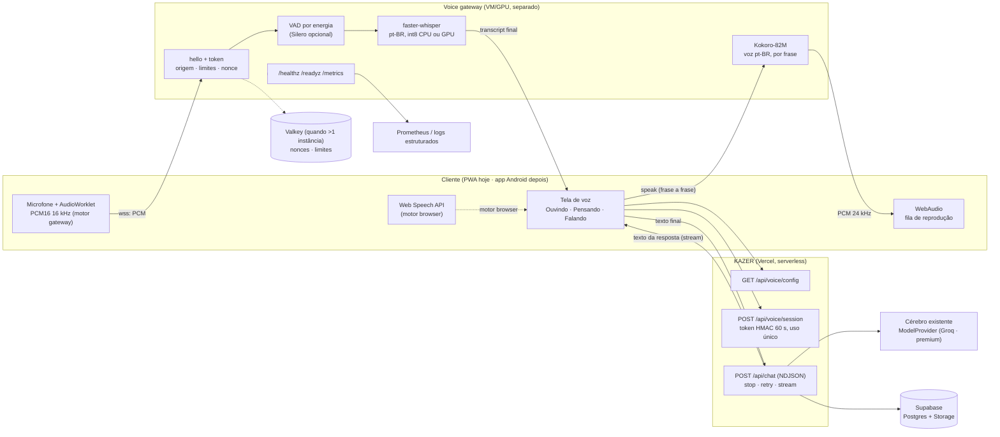

# Arquitetura do modo voz

## 1. Auditoria do repositório (feita antes de editar, 2026-11-08)

- **Git:** árvore limpa em `main` (`0a33ad4`). Trabalho feito no branch
  `feat/kazer-modo-voz`, sem reescrever histórico.
- **Deploy:** Vercel com o preset Python (`vercel.json`), app ASGI em
  `kazer.interfaces.web.asgi:app`. Funções serverless: nada de conexões longas,
  disco efêmero. Por isso o áudio **não** pode morar na função da Vercel.
- **Backend:** Starlette 1.x. Rotas em `kazer/interfaces/web/app.py` (auth) e
  `chat_api.py` (chat). Defesas: cookie HttpOnly/SameSite, `check_origin` (CSRF
  por Origin + Sec-Fetch-Site), corpo com teto, CSP estrita (`connect-src 'self'`),
  `Permissions-Policy: camera=(), microphone=(self)`, rate limiter em memória.
- **Chat:** `/api/chat` em NDJSON com `client_id` para deduplicar reenvios;
  `/api/messages/{id}/stop`, `/retry`, `/stream` (reatar). Persistência no
  Supabase (Postgres + Storage) ou SQLite local fora de serverless.
- **Cérebro:** abstração `ModelProvider` em `kazer/brain/` (Groq "KAZ 1.1" + premium).
- **Frontend:** JS puro em `kazer/interfaces/web/static/assets`, PWA com
  service worker. Já havia ditado (`voice.js`) via Web Speech API, com a regra
  "o KAZER recebe só o texto, sem segunda captura de microfone".
- **Android nativo:** não existe no repositório (há `docs/android-migration-audit.md`).
- **Fila/cache distribuído:** não existe. Rate limit é por instância.
- **Testes:** `pytest` (269 antes desta mudança), `ruff`. CI no GitHub Actions.

## 2. Decisões

1. **Um cérebro só.** O texto reconhecido entra pelo `/api/chat` existente, pelo
   mesmo `send()` do composer: vira mensagem normal da conversa, conta no uso,
   respeita planos, memória e segurança, e é deduplicado pelo `client_id`. O
   gateway nunca chama o modelo e não tem chave nenhuma.
2. **Dois motores, um protocolo de app.** `browser` (padrão, custo zero, roda já)
   e `gateway` (auto-hospedado, voz Kokoro, nível real do microfone, interrupção
   por VAD). O servidor diz qual usar em `/api/voice/config`; se o gateway falhar
   ao conectar, o cliente cai para o navegador sem derrubar nada.
3. **Gateway fora da Vercel.** Processo Python separado (`python -m
   kazer.voice.gateway`), sem banco, escalável e degradável sozinho.
4. **Autorização sem cookie no gateway.** O KAZER emite um token HMAC de 60 s, de
   uso único (`/api/voice/session`); o gateway só confere. Funciona igual para
   o app nativo.
5. **WebSocket antes de WebRTC.** PCM16 16 kHz em quadros de 20 ms (~32 kB/s).
   WebRTC (aiortc/LiveKit) só quando a latência de rede móvel ruim justificar —
   ver CAPACITY.md.
6. **Nada de áudio guardado.** Áudio vive na memória até virar texto e é
   descartado. Transcrições viram mensagens comuns (mesma exclusão/exportação).

## 3. Diagrama

## 4. Ciclo de uma conversa

1. Campo vazio → botão dourado de onda → tela de voz (pedido de microfone só
   aqui, depois do toque).
2. **Ouvindo:** navegador reconhece (ou gateway: VAD fecha a fala após 700 ms de
   silêncio). Fala curta demais (< 250 ms) é descartada como ruído.
3. **Pensando:** texto final vai ao `/api/chat`. Se a pessoa falar de novo com
   resposta em andamento, a resposta é parada e a fala nova é enviada.
4. **Falando:** cada frase completa do stream vira fala assim que chega
   (`speakable()` tira markdown, código, links e citações; perguntas
   `kazer-pergunta` são lidas com as opções).
5. Acabou a fala → volta a ouvir. Toque no centro interrompe: cancela o áudio,
   esvazia a fila de frases e chama `/stop` na geração.
6. Fechar (X, Esc ou "Digitar") para o microfone na hora.

## 5. Diferenças em relação ao brief

- O brief pede waveform com nível real. No motor **browser** isso exigiria uma
  segunda captura de microfone, que a regra do KAZER proíbe (e que dava
  `NotAllowedError` em PWAs Android). Lá o centro reage só a estados e às
  fronteiras de palavra reais da síntese. No motor **gateway** o nível vem do
  `AnalyserNode` do microfone de verdade.
- No motor browser, interromper é por toque (o navegador não ouve enquanto fala,
  o que também evita eco). Interrupção por voz (barge-in) existe no gateway.
