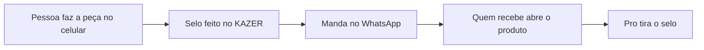

# Pesquisa 13 de outubro de 2026

Fontes abertas do dia. Esta nota **soma** a [6 de outubro](PESQUISA-2026-10.md), a [7](PESQUISA-2026-10-07.md), a [9](PESQUISA-2026-10-09.md) e a [12](PESQUISA-2026-10-12.md). Não apaga catálogo, ateliê nem caixa. Não mexe em `interface/`, `api/` nem `database/`.

Regra que continua: a casa não aluga GPU. O arquivo da pessoa não sobe para a Vercel. Quem desenha é o aparelho dela.

Nada nesta página está no ar. O que está no ar continua sendo a tabela “Já no ar” do README.

## Por que esta bancada e não outra

As notas de 6 a 12 já cobrem selo, brand kit, social, voz, proposta, PDF, foto, recorte, deck, cartão de link, OCR, fundo, vitrine, cartaz, ícone, contraste, carrossel, QR de Pix da pessoa, recibo e briefing.

O buraco de 13/10 é o **balcão**: a peça que a loja e o designer mandam no WhatsApp no mesmo dia. Cada saída grátis leva o selo “feito no KAZER”. O selo é o anúncio. A casa não paga impulsionamento.

## Caixa — conferido de novo

Página pública de preços da Abacate em 13/10 ([pricing](https://www.abacatepay.com/pricing)):

| Movimento | Taxa publicada | Mensalidade |
|---|---|---|
| Receber Pix | R$ 0,80 | R$ 0 |
| Gerar QR de cobrança da casa | R$ 0 | R$ 0 |
| Sacar, até 20 vezes no mês | R$ 0,80 | R$ 0 |
| Sacar, a partir da 21ª | R$ 2,50 | R$ 0 |
| Cartão à vista | 3,5% + R$ 0,60 | R$ 0 |
| Cartão 2x a 6x | 4% + R$ 0,60 | R$ 0 |
| Cartão 7x a 12x | 4,5% + R$ 0,60 | R$ 0 |

No plano de R$ 29, o Pix (R$ 0,80) continua mais barato que o cartão. Parcelar no cartão não entra no plano livre. A conta de 40 × R$ 29 continua ~R$ 1.160 brutos e ~R$ 32 de taxa de receber, se essas pessoas pagarem. Repositório bonito não cobra ninguém.

## O que o designer e a banca pagam lá fora

| Peça | Quem cobra lá fora | No KAZER, a R$ 0 | Licença |
|---|---|---|---|
| Etiqueta de gôndola | Sistema de etiqueta com mensalidade, ou gráfica para uma folha | Preço, nome e código de barras CODE128 no canvas. Imprimir no celular. | [JsBarcode](https://github.com/lindell/JsBarcode) 3.12.3, MIT. Pode. Não é nota fiscal e não fala com a SEFAZ. |
| Cardápio de uma folha | Designer cobra a arte do cardápio | HTML imprimível. Português, ou português e japonês com `writing-mode` e fonte do aparelho. | Código da casa. Pode. Sem baixar fonte de terceiro. |
| Assinatura no papel | DocuSign e certificado cobram por envelope | [signature_pad](https://github.com/szimek/signature_pad) 5.1.4, MIT. O traço vira PNG e entra no recibo ou na proposta que **já estão planejados**. | MIT. Pode. Não é ICP-Brasil e não é assinatura eletrônica. |
| Marca d'água em lote | App de story cobra para tirar a marca dele | Canvas. Plano livre desenha “feito no KAZER”. O Pro, quando a compra existir, tira esse selo e aceita o logo da pessoa. | Código da casa. A foto não sai do aparelho. |
| Figurinha 512 | Pack de figurinha pago | Quadrado 512 feito no canvas. A pessoa salva e usa onde quiser. | Código da casa. Não é pack oficial e não usa marca de aplicativo de mensagem. |
| Story em vídeo curto | CapCut e afins cobram para exportar sem selo | `MediaRecorder` do navegador, em cima dos frames do carrossel da nota de 12/10. Em geral sai WebM. | API nativa. Pode. Sem FFmpeg.wasm (a nota de 9/10 já vetou build GPL). |
| QR do Wi-Fi da loja | Gerador com anúncio | Texto público `WIFI:T:WPA;S:…;P:…;;` desenhado com a mesma biblioteca MIT de QR já prevista em 12/10. | Spec pública. A senha não vai para a Vercel. Não é o Pix e não é o caixa do Pro. |
| Anotador de print | Captura anotada é recurso de app pago | Seta, texto e tarja no canvas, na foto local. | Código da casa. Sem Fabric.js nesta etapa. |
| Cartão PT · JP | Gráfica cobra as duas faces | Duas faces, texto vertical no japonês, QR de contato (vCard) no mesmo desenho de QR. | Código da casa. Pode. |
| Antes / depois | Plugin de comparação no editor | Um controle CSS por cima de duas fotos locais. | CSS. Pode. |
| Semana de posts | Later, mLabs e planilha paga | O Brain que **já existe** devolve sete linhas. O papel só imprime. | Não é modelo novo. Cota do visitante continua fechada. |

### O que isto não é

- A etiqueta não emite nota, não guarda estoque e não substitui o contador.
- A assinatura desenhada não vale como certificado digital.
- O QR do Wi-Fi não é a chave Pix da pessoa (isso já está na nota de 12/10) e não é a cobrança do Kazer Pro.
- O vídeo curto não promete MP4 em todo celular. Onde o navegador só grava WebM, entrega WebM.
- OpenPencil, Graphite e Penpot são editores inteiros. Servem de referência, não entram como dependência no lugar do chat.

### Armadilha que continua de pé

A nota de 9/10 veta AGPL (`@imgly/background-removal`), modelo não comercial, FFmpeg.wasm em build GPL e tldraw sem ler a licença do ano. Esta nota não reabre nenhum desses. Também não entra API de vídeo, de figurinha ou de etiqueta: o custo voltaria para a casa.

## IA — melhorar sem modelo novo

Igual à nota de 12/10, com um uso a mais:

1. **Modo balcão** — um pedido só, com teto, no provedor que já está configurado. A resposta é curta: nome do prato ou do produto, preço em texto, sete linhas de post. Não é geração de imagem.
2. **Roteador vivo** — se um ID aposentou, o próximo da lista que já existe assume. Não criar conta nova nem ligar GPU.
3. **Cota do visitante** — um anônimo não pode comer o teto diário da organização. As ferramentas de canvas não chamam o Brain. Só a semana de posts chama, e com o mesmo teto do briefing.
4. **Chrome de mesa** — continua o plano de 9/10. Celular segue no Brain. Não trocar o Brain.

## Ordem para construir, quando for código

Cada item nasce como módulo novo. O composer do chat fica. O carrossel, o recibo e a proposta das notas anteriores ficam.

1. **Marca d'água em lote** — é a peça que carrega o nome. Arquivo não sai do celular.
2. **Etiqueta de gôndola** — a banca usa no mesmo dia.
3. **QR do Wi-Fi** — imprime uma vez e cola no balcão.
4. **Cardápio de uma folha** — PT, com face JP opcional.
5. **Anotador de print** — leve, sem rede.
6. **Assinatura no papel** — por cima do recibo e da proposta já planejados. Não cria um terceiro documento.
7. **Cartão PT · JP** e **figurinha 512** — duas exportações do mesmo canvas.
8. **Antes / depois** — CSS, sem biblioteca.
9. **Story em vídeo** — só depois do carrossel da nota de 12/10 existir. Sem FFmpeg.
10. **Semana de posts** — em cima do Brain atual, sem provedor novo.

O que o Pro passa a vender, sem GPU nova, continua o da nota de 9/10: exportação sem selo, kit guardado na conta, arquivo pesado no aparelho (IndexedDB). Esta bancada acrescenta o logo da própria banca no lugar do selo, e o hábito de voltar porque a etiqueta e o cardápio nascem aqui.

## O que não fazer

- Não apagar chat, pesquisa, workspace, PWA nem as pesquisas de 6, 7, 9 e 12 de outubro.
- Não tratar esta tabela como recurso já publicado.
- Não subir foto, senha de Wi-Fi, traço de assinatura ou chave Pix para o servidor.
- Não alugar GPU, API de vídeo ou API de etiqueta no plano livre.
- Não chamar a etiqueta de nota fiscal nem a assinatura de certificado.
- Não trocar o Brain, o composer ou o visual que já está em `docs/visual-system.md`.
