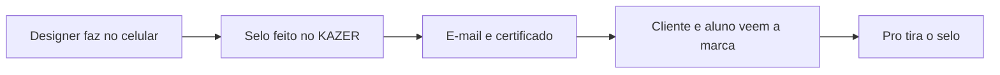

# Pesquisa 14 de outubro de 2026

Fontes abertas do dia. Esta nota **soma** a [6 de outubro](PESQUISA-2026-10.md), a [7](PESQUISA-2026-10-07.md), a [9](PESQUISA-2026-10-09.md), a [12](PESQUISA-2026-10-12.md) e a [13](PESQUISA-2026-10-13.md). Não apaga catálogo, ateliê nem caixa. Não mexe em `interface/`, `api/` nem `database/`.

Regra que continua: a casa não aluga GPU. O arquivo da pessoa não sobe para a Vercel. Quem desenha é o aparelho dela.

Nada nesta página está no ar. O que está no ar continua sendo a tabela “Já no ar” do README.

## Por que esta mesa e não outra

As notas de 6 a 13 já cobrem selo, brand kit, social, voz, proposta, PDF, foto, recorte, deck, cartão de link, OCR, fundo, vitrine, cartaz, ícone, contraste, carrossel, QR de Pix da pessoa, recibo, briefing, etiqueta, cardápio, assinatura desenhada no papel, marca d'água, figurinha, story, Wi-Fi, print anotado, cartão PT · JP, antes/depois e semana de posts.

O buraco de 14/10 é a **mesa do designer**: a peça que sai do celular e chega no cliente sem a pessoa abrir Canva, Milanote ou um planner pago. Cada saída grátis leva o selo “feito no KAZER”. O e-mail e o certificado viajam sozinhos. A casa não paga anúncio.

## Caixa — conferido de novo

Página pública de preços da Abacate em 14/10 ([pricing](https://www.abacatepay.com/pricing)). Nada mudou em relação ao dia 13:

| Movimento | Taxa publicada | Mensalidade |
|---|---|---|
| Receber Pix | R$ 0,80 | R$ 0 |
| Gerar QR de cobrança da casa | R$ 0 | R$ 0 |
| Sacar, até 20 vezes no mês | R$ 0,80 | R$ 0 |
| Sacar, a partir da 21ª | R$ 2,50 | R$ 0 |
| Cartão à vista | 3,5% + R$ 0,60 | R$ 0 |
| Cartão 2x a 6x | 4% + R$ 0,60 | R$ 0 |
| Cartão 7x a 12x | 4,5% + R$ 0,60 | R$ 0 |

A mesma página publica o que as notas anteriores não tinham escrito: saque mínimo de R$ 3,50 e TED a R$ 5,00. Nenhum dos dois entra no plano livre. No plano de R$ 29, o Pix (R$ 0,80) continua mais barato que o cartão. A conta de 40 × R$ 29 continua ~R$ 1.160 brutos e ~R$ 32 de taxa de receber, se essas pessoas pagarem. Repositório bonito não cobra ninguém.

## O que o designer paga lá fora

| Peça | Quem cobra lá fora | No KAZER, a R$ 0 | Licença |
|---|---|---|---|
| Assinatura de e-mail | [WiseStamp](https://www.wisestamp.com/pricing/) publica Pro+ a partir de US$ 9/mês. Newoldstamp, em resumo público de 9/10/2026, aparecia na faixa de US$ 1,80 por assinatura/mês no anual, com planos de marca citados a partir de uns US$ 7–8. | Tabela HTML, cor e links. A pessoa cola no Gmail ou no Outlook. Sem hospedar foto: imagem só se ela já tiver uma URL pública. | Código da casa. Pode. Não é painel de equipe nem campanha de banner. |
| Certificado de oficina | Modelo de certificado trancado no Canva Pro. | HTML para imprimir: nome, oficina, data. O grátis leva “feito no KAZER”. | Código da casa. Pode. Não é diploma e não vale no MEC. |
| Rampa de cor | Coolors e afins travam o sistema exportável. O par de contraste da nota de 12/10 não monta uma escala. | [culori](https://github.com/Evercoder/culori) 4.0.2, MIT. Uma cor vira rampa, hex e `oklch()`, mais variáveis CSS. | MIT. Pode. Não substitui o par WCAG de 12/10. |
| Folha de gráfica | A arte “sem sangria” volta da gráfica cobrada de novo. | SVG com marca de corte, sangria de 3 mm (costume de gráfica, não lei) e área segura. Na mesma tela: px ↔ mm a 300 dpi (`mm = px / dpi × 25,4`). | Código da casa. Pode. Não é o cardápio nem a etiqueta; é a margem em volta deles. |
| Grade 3×3 | [Planoly](https://www.planoly.com/help/account-and-workspace/choose-a-paid-plan), ajuda atualizada em 9/10/2026: Starter US$ 16/mês no mensal ou US$ 14 no anual. O grátis do app fica em 10 envios por mês. | Nove fotos locais, a ordem do grid, um PNG. | Canvas. Pode. Não publica no Instagram e não usa API da rede. Não é o carrossel 1080×1350 da nota de 12/10. |
| Prancha | [Milanote](https://milanote.com/plans), lido em 14/10: grátis até 100 notas e 10 arquivos; “Pay per person” US$ 12,50/mês ou US$ 9,99/mês no anual. | Fotos locais num quadro CSS. Exportar PNG ou imprimir. | CSS. Pode. Não é quadro compartilhado e não é o antes/depois de 13/10. |
| Quanto cobrar | Planilha e curso de precificação. O MEI paga para alguém fazer a conta. | Hora, material, margem e desconto, no celular. O preço sugerido fica na tela. | Código da casa. Pode. Não é contador, não calcula imposto oficial e não guarda livro-caixa. |
| Vale da banca | App de fidelidade com mensalidade, para um papel de desconto. | Código sorteado no aparelho, impresso com a validade. Não sobe para a Vercel. | Código da casa. Pode. Não é cupom fiscal, não é NFC-e e não é a cobrança do Pro. |

### O que isto não é

- A assinatura de e-mail não é a assinatura desenhada no papel (isso já está na nota de 13/10) e não gerencia a equipe inteira.
- O certificado não é diploma, certificado digital nem documento de órgão público.
- A grade não posta, não agenda e não pede login de rede social.
- O vale não é o QR de Pix da pessoa (nota de 12/10) nem o caixa do Kazer Pro.
- A rampa não substitui o teste de contraste. Os dois ficam.

### Armadilha que continua de pé

A nota de 9/10 veta AGPL (`@imgly/background-removal`), modelo não comercial, FFmpeg.wasm em build GPL e tldraw sem ler a licença do ano. Esta nota não reabre nenhum desses. Também não entra API de e-mail, de mockup, de Instagram ou de cor: o custo voltaria para a casa.

## IA — melhorar sem modelo novo

Igual às notas de 12 e 13, com um uso a mais:

1. **Modo mesa** — um pedido só, com teto, no provedor que já está configurado. A resposta é curta: três passos da rampa em palavras, uma linha para o certificado, uma linha debaixo do nome na assinatura. Não é geração de imagem.
2. **Roteador vivo** — se um ID aposentou, o próximo da lista que já existe assume. Não criar conta nova nem ligar GPU.
3. **Cota do visitante** — um anônimo não pode comer o teto diário da organização. As ferramentas de canvas não chamam o Brain. Só o modo mesa chama, e com o mesmo teto do briefing.
4. **Chrome de mesa** — continua o plano de 9/10. Celular segue no Brain. Não trocar o Brain.

## Ordem para construir, quando for código

Cada item nasce como módulo novo. O composer do chat fica. O carrossel, o recibo, a etiqueta e o cardápio das notas anteriores ficam.

1. **Assinatura de e-mail** — sai todo dia e carrega o nome. Sem hospedar arquivo.
2. **Certificado de oficina** — uma sala inteira vê o selo.
3. **Rampa OKLCH** — culori MIT, sem rede depois do carregamento da biblioteca.
4. **Folha de gráfica** — margem em volta das peças que já estão planejadas. Sem biblioteca.
5. **Grade 3×3** — fotos locais, um PNG.
6. **Prancha** — o mesmo limite: arquivo não sai do celular.
7. **Quanto cobrar** — conta local, com o aviso de que não é o contador.
8. **Vale da banca** — papel. O código nasce e morre no aparelho.

O que o Pro passa a vender, sem GPU nova, continua o da nota de 9/10: exportação sem selo, kit guardado na conta, arquivo pesado no aparelho (IndexedDB). Esta mesa acrescenta o logo da pessoa no lugar do selo, na assinatura e no certificado.

## O que não fazer

- Não apagar chat, pesquisa, workspace, PWA nem as pesquisas de 6, 7, 9, 12 e 13 de outubro.
- Não tratar esta tabela como recurso já publicado.
- Não subir foto, lista de alunos, preço do cliente ou código de vale para o servidor.
- Não alugar GPU, API de e-mail, API de cor ou API de rede social no plano livre.
- Não chamar o certificado de diploma nem o vale de cupom fiscal.
- Não trocar o Brain, o composer ou o visual que já está em `docs/visual-system.md`.
