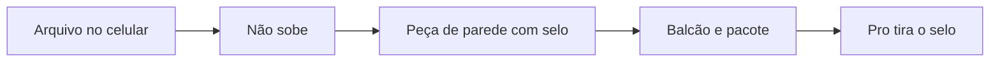

# Pesquisa 15 de outubro de 2026

Fontes abertas do dia. Esta nota **soma** a [6 de outubro](PESQUISA-2026-10.md), a [7](PESQUISA-2026-10-07.md), a [9](PESQUISA-2026-10-09.md), a [12](PESQUISA-2026-10-12.md), a [13](PESQUISA-2026-10-13.md) e a [14](PESQUISA-2026-10-14.md). Não apaga catálogo, ateliê nem caixa. Não mexe em `interface/`, `api/` nem `database/`.

Regra que continua: a casa não aluga GPU. O arquivo da pessoa não sobe para a Vercel. Quem desenha é o aparelho dela.

Nada nesta página está no ar. O que está no ar continua sendo a tabela “Já no ar” do README.

## Por que esta gaveta e não outra

As notas de 6 a 14 já cobrem selo, brand kit, social, voz, proposta, PDF que já é PDF, foto, recorte, deck, cartão de link, OCR, fundo, vitrine, cartaz, ícone, contraste, carrossel, QR de Pix da pessoa, recibo, briefing, etiqueta, cardápio, assinatura no papel, marca d'água, figurinha, story, Wi-Fi, print anotado, cartão PT · JP, antes/depois, semana de posts, e-mail, certificado, rampa, gráfica, grade, prancha, preço e vale.

O buraco de 15/10 é a **gaveta**: o arquivo que a pessoa não pode mandar para um site. Foto do iPhone, comprovante, CPF no canto, localização no EXIF, foto 3×4, contato, e o papel que fica no balcão o ano inteiro. Lá fora o grátis pede upload ou cobra para tirar o selo. Aqui o arquivo nasce e morre no aparelho. A casa não paga armazenamento nem anúncio.

Documento sensível não leva selo. Os dois jeitos de cobrar estão abaixo. Os dois custam R$ 0 de infra.

## Caixa — conferido de novo

Página pública de preços da Abacate em 15/10 ([pricing](https://www.abacatepay.com/pricing)). Nada mudou em relação ao dia 14:

| Movimento | Taxa publicada | Mensalidade |
|---|---|---|
| Receber Pix | R$ 0,80 | R$ 0 |
| Gerar QR de cobrança da casa | R$ 0 | R$ 0 |
| Sacar, até 20 vezes no mês | R$ 0,80 | R$ 0 |
| Sacar, a partir da 21ª | R$ 2,50 | R$ 0 |
| Cartão à vista | 3,5% + R$ 0,60 | R$ 0 |
| Cartão 2x a 6x | 4% + R$ 0,60 | R$ 0 |
| Cartão 7x a 12x | 4,5% + R$ 0,60 | R$ 0 |

Saque mínimo de R$ 3,50 e TED a R$ 5,00 continuam fora do plano livre. No plano de R$ 29, o Pix (R$ 0,80) continua mais barato que o cartão. A conta de 40 × R$ 29 continua ~R$ 1.160 brutos e ~R$ 32 de taxa de receber, se essas pessoas pagarem. Repositório bonito não cobra ninguém. Esta gaveta também não: nenhuma peça chama GPU e nenhuma guarda arquivo.

## Dois jeitos de cobrar, os dois sem gastar para abrir

| Saída | Grátis | Pro, quando a compra existir |
|---|---|---|
| Peça de parede ou de pacote: foto 3×4, cartaz de avaliação, cartão .vcf, obrigado do pedido | Leva “feito no KAZER” | Tira o selo e pode levar o logo da pessoa |
| Documento e privacidade: HEIC, fotos → PDF, tarja, cópia sem GPS | Um arquivo por vez, sem selo em cima do dado | Lote, ainda no aparelho |

O selo no cartaz fica no balcão por meses. O selo no obrigado entra em todo pacote. A casa não paga impulsionamento. Quem imprime para cliente não quer a marca de outro no papel: esse é o Pro de R$ 29.

O lote do Pro, quando for código, usa [JSZip](https://github.com/Stuk/jszip) 3.10.2 **pela licença MIT**. O pacote é duplo (MIT ou GPL-3.0). O lado GPL não entra. O zip nasce no celular. Não sobe.

## O que a pessoa paga lá fora

| Peça | Quem cobra lá fora | No KAZER, a R$ 0 | Licença |
|---|---|---|---|
| HEIC → JPEG | Conversor na web pede a foto. `heic-to` 1.6.6 (npm, por volta de 11/10/2026) segue o libheif para o Chrome. | Onde o navegador já abre HEIC, o canvas grava JPEG. Onde não abre, a tela ensina o ajuste “Mais compatível” do iPhone. A foto não vai para site nenhum. | Código da casa. Pode. Não empacota libheif. |
| Fotos → um PDF | Smallpdf e iLovePDF recebem o arquivo. Resumo público de 9/10/2026 ([PulseSignal](https://getpulsesignal.com/pricing/smallpdf), a partir da página de preços) fala em grátis com download limitado e pago desde US$ 8/mês no anual. A página do Smallpdf, nesta leitura de 15/10, não devolveu o valor — o preço não vira fato de hoje. O fato é o upload. | [pdf-lib](https://github.com/Hopding/pdf-lib), MIT, o mesmo da nota de 9/10. Várias fotos locais viram um PDF para o WhatsApp. | MIT. Pode. Não é juntar PDF com PDF: isso já está na nota de 9/10. |
| Cópia sem GPS | Site de “tirar metadados” pede a foto. | [exifr](https://github.com/MikeKovarik/exifr) 7.1.3, MIT, só lê e avisa “esta foto tem localização”. O canvas grava um JPEG novo. EXIF não sobrevive a essa gravação. | MIT para ler. Pode. Não é o compressor da nota de 9/10: aquele reduz peso e tira paleta. Este mostra o risco e entrega a cópia limpa. |
| Tarja de dado | iLovePDF tarja, mas o documento sobe. | Retângulo preto no canvas, em cima de CPF, conta ou telefone, antes de entrar no PDF. | Código da casa. Pode. Não é o anotador de print da nota de 13/10. Não é prova jurídica. |
| Foto 3×4 | App Store, [Foto 3×4: Documentos, Concurso](https://apps.apple.com/br/app/foto-3x4-documentos-concurso/id6754182599), listagem pública lida em 15/10: grátis com anúncio. Salvar uma vez R$ 4,90. Tirar a marca d'água de uma foto R$ 4,90. Sem anúncios para sempre R$ 9,90. Salvamentos ilimitados R$ 9,90. | Guia na tela, recorte 30×40 mm, e folha 10×15 com a mesma foto repetida. 35×45 mm fica ao lado (medida comum de foto de documento no Japão). 51×51 mm para quem cita o visto americano. | Código da casa. pdf-lib só se a folha precisar de milímetro. Pode. Não é o governo e não promete que o órgão aceita. A pessoa confere a norma. O recorte da nota de 9/10, se um dia existir, pode ajudar no fundo. Não entra modelo novo. |
| Cartão .vcf | [HiHello](https://www.hihello.com/pricing), lido em 15/10: Personal grátis; Professional US$ 6/mês, US$ 72 no ano, com cartão de marca. Ajuda do Blinq, atualizada por volta de 7/10: Premium US$ 9,99/mês ou US$ 7,33 no anual. Os dois hospedam o cartão. | Arquivo `.vcf` (texto) mais um PNG. O QR reusa o gerador já previsto na nota de 12/10 e aponta para o WhatsApp da pessoa. | Código da casa. Pode. Não hospeda perfil. Não é o cartão impresso PT · JP da nota de 13/10 nem a assinatura de e-mail da nota de 14/10. |
| Cartaz de avaliação | Gerador grátis com anúncio, para um papel que fica meses no balcão. | A pessoa cola o link de avaliação que o mapa já deu à loja dela. HTML para imprimir, tamanho de balcão. | Código da casa. Pode. Não é o QR de Pix (12/10) nem o QR de Wi-Fi (13/10). O KAZER não cria a ficha da loja. |
| Obrigado do pedido | Modelo de cartão de agradecimento trancado no Canva Pro. Quem vende no Instagram e na Shopee manda um papel em todo pacote. | HTML de um cartão pequeno: nome da banca, uma linha, data. | Código da casa. Pode. Não é o certificado de oficina (14/10) nem cupom fiscal. |

### O que isto não é

- HEIC → JPEG não é desculpa para empacotar codec. Se o navegador não abre, a pessoa exporta JPEG no próprio iPhone. Não há fallback que sobe a foto.
- Fotos → PDF não substitui juntar, separar e girar PDF. Os dois ficam. Um começa em foto. O outro começa em PDF.
- A tarja de dado não é o anotador de print (seta, texto, tarja de explicação). Uma esconde CPF. A outra explica um print.
- A foto 3×4 não é RG, passaporte nem visto emitido pelo KAZER.
- O .vcf não é página hospedada, não é link na bio e não é o favicon da nota de 12/10.
- O cartaz não publica avaliação e não pede login de mapa.
- O obrigado não é nota, não é etiqueta de envio e não imita documento dos Correios.

### Armadilha que continua de pé

A nota de 9/10 veta AGPL (`@imgly/background-removal`), modelo não comercial, FFmpeg.wasm em build GPL e tldraw sem ler a licença do ano. Esta nota não reabre nenhum desses.

O [libheif](https://github.com/strukturag/libheif), lido em 15/10, se distribui sob a GNU Lesser General Public License. É a mesma família de binário de codec que a nota de 9/10 deixou de fora. Não entra wasm de libheif, nem `heic-to`, no plano livre. Se um dia a casa quiser a LGPL, isso é decisão lida com calma, num módulo separado — não é o atalho de hoje.

Tampouco entra API de imagem, de PDF ou de mapa: o custo voltaria para a casa, e o arquivo sairia do celular.

## IA — melhorar sem modelo novo e sem ver o arquivo

1. **Estas oito peças não chamam o Brain.** Foto, PDF, CPF, GPS e contato não vão para provedor nenhum. Esse é o produto.
2. **Uma frase, se a pessoa pedir** — no cartaz de avaliação ou no obrigado, um clique, uma linha, com o mesmo teto do briefing. Não é geração de imagem. O arquivo continua fora.
3. **Roteador vivo** — se um ID aposentou, o próximo da lista que já existe assume. Não criar conta nova nem ligar GPU.
4. **Cota do visitante** — ferramenta de canvas não come o teto. Só a frase opcional chama, e com o teto que já existe.
5. **Chrome de mesa** — continua o plano de 9/10. Celular segue no Brain. Não trocar o Brain.

## Ordem para construir, quando for código

Cada item nasce como módulo novo. O composer do chat fica. O PDF, o compressor, o anotador, o QR e o certificado das notas anteriores ficam.

1. **Fotos → um PDF** — a dor de todo dia no WhatsApp. pdf-lib já escolhido. Sem selo em cima de documento.
2. **Cópia sem GPS** — a frase que a pessoa repete. exifr só lê. O canvas apaga.
3. **Tarja de dado** — antes do PDF sair do celular.
4. **Foto 3×4** — a peça de R$ 4,90. A folha impressa carrega o selo no grátis.
5. **Cartaz de avaliação** — fica no balcão.
6. **Obrigado do pedido** — entra em todo pacote.
7. **Cartão .vcf** — sem hospedar perfil. QR do gerador que já está no plano.
8. **HEIC** — só onde o navegador já decodifica. Sem libheif.

O zip do lote vem depois das oito, e só no Pro, pela licença MIT. Não antes.

O que o Pro passa a vender, sem GPU nova, continua o da nota de 9/10: exportação sem selo, kit guardado na conta, arquivo pesado no aparelho (IndexedDB). Esta gaveta acrescenta o lote local e o logo da pessoa no lugar do selo, na folha 3×4, no cartaz, no .vcf e no obrigado.

## O que não fazer

- Não apagar chat, pesquisa, workspace, PWA nem as pesquisas de 6, 7, 9, 12, 13 e 14 de outubro.
- Não tratar esta tabela como recurso já publicado.
- Não subir foto, HEIC, CPF, localização, contato ou PDF de documento para o servidor.
- Não alugar GPU, API de imagem, API de PDF ou API de mapa no plano livre.
- Não empacotar libheif, FFmpeg ou biblioteca AGPL.
- Não chamar a foto 3×4 de documento oficial nem o obrigado de nota fiscal.
- Não hospedar cartão de visita na Vercel.
- Não carimbar selo em cima de RG, CPF ou comprovante.
- Não trocar o Brain, o composer ou o visual que já está em `docs/visual-system.md`.
