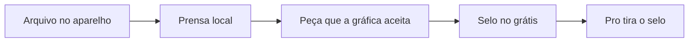

# Pesquisa 16 de outubro de 2026

Fontes abertas do dia. Esta nota **soma** a [6 de outubro](PESQUISA-2026-10.md), a [7](PESQUISA-2026-10-07.md), a [9](PESQUISA-2026-10-09.md), a [12](PESQUISA-2026-10-12.md), a [13](PESQUISA-2026-10-13.md), a [14](PESQUISA-2026-10-14.md) e a [15](PESQUISA-2026-10-15.md). Não apaga catálogo, ateliê nem caixa. Não mexe em `interface/`, `api/` nem `database/`.

Regra que continua: a casa não aluga GPU. O arquivo da pessoa não sobe para a Vercel. Quem desenha é o aparelho dela.

Nada nesta página está no ar. O que está no ar continua sendo a tabela “Já no ar” do README.

## Por que esta prensa e não outra

As notas de 6 a 15 já cobrem selo, brand kit, social, voz, proposta, PDF que já é PDF, foto, recorte de pessoa, deck, cartão de link, OCR, fundo, vitrine, cartaz de link, ícone, contraste, carrossel, QR de Pix da pessoa, recibo, briefing, etiqueta, cardápio, assinatura no papel, marca d'água, figurinha, story, Wi-Fi, print anotado, cartão PT · JP, antes/depois, semana de posts, e-mail, certificado, rampa, folha de sangria, grade, prancha, preço, vale, HEIC, PDF de fotos, GPS, tarja, 3×4, .vcf, cartaz de avaliação e obrigado.

O buraco de 16/10 é a **prensa**: o arquivo que a gráfica devolve e o anúncio que a pessoa publica sem saber quanto sobra. Logo que ainda é JPG, fundo branco que não é transparente, foto que pedia duas tintas, arte sem pixel bastante, caixa sem molde, preço que esquece a comissão, cartaz DE/POR e o ícone do site. Lá fora o grátis pede upload, põe marca ou cobra mensalidade. Aqui o arquivo nasce e morre no aparelho. A casa não paga armazenamento, GPU nem anúncio.

Número de conta não leva selo. Peça que a pessoa imprime ou manda para o cliente leva. Os dois jeitos de cobrar estão abaixo. Os dois custam R$ 0 de infra.

## Caixa — conferido de novo

Página pública de preços da Abacate em 16/10 ([pricing](https://www.abacatepay.com/pricing)). Nada mudou em relação ao dia 15:

| Movimento | Taxa publicada | Mensalidade |
|---|---|---|
| Receber Pix | R$ 0,80 | R$ 0 |
| Gerar QR de cobrança da casa | R$ 0 | R$ 0 |
| Sacar, até 20 vezes no mês | R$ 0,80 | R$ 0 |
| Sacar, a partir da 21ª | R$ 2,50 | R$ 0 |
| Cartão à vista | 3,5% + R$ 0,60 | R$ 0 |
| Cartão 2x a 6x | 4% + R$ 0,60 | R$ 0 |
| Cartão 7x a 12x | 4,5% + R$ 0,60 | R$ 0 |

Saque mínimo de R$ 3,50 e TED a R$ 5,00 continuam fora do plano livre. Boleto pago continua R$ 2,50, ou R$ 0,80 se a pessoa pagar o boleto com Pix. No plano de R$ 29, o Pix (R$ 0,80) continua mais barato que o cartão. A conta de 40 × R$ 29 continua ~R$ 1.160 brutos e ~R$ 32 de taxa de receber, se essas pessoas pagarem. Repositório bonito não cobra ninguém. Esta prensa também não: nenhuma peça chama GPU e nenhuma guarda arquivo.

## Dois jeitos de cobrar, os dois sem gastar para abrir

| Saída | Grátis | Pro, quando a compra existir |
|---|---|---|
| Peça que viaja: SVG do logo, duotone, cartaz DE/POR, molde, folha de ícones, boletim impresso da gráfica | Leva “feito no KAZER” | Tira o selo e pode levar o logo da pessoa |
| Número: DPI na tela, lucro da vitrine na tela | Um cálculo, sem selo em cima do número | A folha impressa sem selo, e o lote, ainda no aparelho |

No logo, o selo do grátis fica **fora da marca**, numa linha embaixo, com viewBox folgado. Não entra nos caminhos do desenho. Senão o cliente da pessoa recebe a nossa marca dentro do logo dela. Quem quer só a marca, viewBox justo, paga o Pro de R$ 29.

O cartaz DE/POR fica na gôndola. O duotone vira cartaz e capa. O molde vai para a gráfica com o nome do KAZER no grátis — o estúdio que entrega para cliente paga o Pro para tirar. A casa não paga impulsionamento.

O lote do Pro, quando for código, reusa o [JSZip](https://github.com/Stuk/jszip) 3.10.2 pela licença MIT, como a gaveta de 15/10. O zip nasce no celular. Não sobe.

## O que a pessoa paga lá fora

| Peça | Quem cobra lá fora | No KAZER, a R$ 0 | Licença |
|---|---|---|---|
| Logo chapado → SVG | A página do Vector Magic, nesta leitura de 16/10, não devolveu preço. Agregador (Capterra) lista a edição online a partir de US$ 5,49/mês e a de mesa em pagamento único. Isso não vira tabela da casa. O fato é: o JPG sobe e a ferramenta cobra. | [ImageTracerJS](https://github.com/jankovicsandras/imagetracerjs) 1.2.6, The Unlicense / domínio público, uso comercial permitido. O arquivo `imagetracer_v1.2.6.js` roda no aparelho. Só logo chapado, poucas cores, lado maior até 1024 px. Se a imagem for foto, a tela recusa e aponta o duotone ou o recorte que já está no plano. | Unlicense. Pode. Não é o vetor nativo do Ateliê (aquele nasce em SVG). Este só traça um logo que já é JPG ou PNG. |
| Branco → transparente | Editor pede o arquivo para “tirar o fundo”. O recorte de pessoa lá fora cobra por crédito. | Canvas. Pixels perto do branco viram alpha 0, com tolerância. Serve logo e carimbo em folha branca. | Código da casa. Pode. Não é o recorte de pessoa da nota de 9/10 (MediaPipe, cabelo e corpo). Não é o compressor da mesma nota. |
| Duotone | Ação de duas tintas no Photoshop, ou modelo travado no Canva Pro. | A foto local vira duas cores: o claro numa tinta, o escuro na outra. PNG no aparelho. | Código da casa. Pode. Não é a rampa OKLCH da nota de 14/10 (culori exporta hex e CSS; não pinta a foto). |
| DPI da gráfica | A gráfica cobra a reimpressão quando a arte não aguenta o tamanho. | A pessoa informa pixels e centímetros. A conta é `dpi = pixels ÷ (cm ÷ 2,54)`. A tela diz se aguenta cartão (hábito de oficina: 300) ou cartaz grande (hábito: 150). | Código da casa. Pode. Não é a folha de sangria da nota de 14/10: aquela marca corte e 3 mm. Esta diz se há pixel bastante. Não é norma de órgão. |
| Caixa simples | Na leitura de 16/10, a [página de preços da Pacdora](https://www.pacdora.com/pricing) mostra plano Free com marca d'água que não sai. Os preços de Lite e Pro não voltaram nesta leitura — não viram número de hoje. O fato é a marca, e o molde que não nasce no celular. | Um SVG: comprimento, largura e altura em milímetro, mais 3 mm de sangria, no estilo caixa de uma aba. | Código da casa. Pode. Não é mockup 3D, não é catálogo de três mil moldes e não promete que a gráfica aceita sem conferir. Não é a etiqueta de envio nem o PDF dos Correios. |
| Conta da vitrine | Planilha de taxa vendida como arquivo digital. Quem erra a comissão vende no prejuízo. | A pessoa digita preço, custo, frete, a porcentagem e a taxa fixa que o painel do anúncio já mostrou. A tela devolve o líquido. | Código da casa. Pode. Não chama API do Mercado Livre nem da Shopee. Não guarda anúncio. |
| Cartaz DE/POR | Modelo de oferta travado no Canva Pro. | HTML de uma folha: preço velho riscado, preço novo, e o desconto que a conta faz. Tamanho de gôndola. | Código da casa. Pode. Não é a etiqueta com código de barras (13/10), não é o cartaz de link (12/10), não é o cartaz de avaliação (15/10) e não é o “quanto cobrar” (14/10). |
| Monograma | Gerador de favicon pede upload do desenho. | Uma ou duas letras. PNG em 16, 32, 180, 192 e 512, mais um SVG de texto. Tudo no aparelho. | Código da casa. Pode. Não é a grade Lucide (12/10), não é o selo oficial da casa (peça 1 do ateliê) e não é o .vcf (15/10). |

### Mercado Livre e Shopee — o número não fica gravado na ferramenta

Ajuda pública do Mercado Livre, lida em 16/10 em [Quanto custa vender um produto?](https://www.mercadolivre.com.br/ajuda/870): criar anúncio não tem custo; ao vender, a tarifa do Clássico fica entre 10% e 14% e a do Premium entre 15% e 19%, conforme a categoria. A própria página manda buscar a categoria para a porcentagem exata. Há faixa com tarifa menor e regra diferente para Supermercado. A casa **não congela** esses intervalos no código. A pessoa digita a porcentagem que o anúncio dela mostrou. Se a tabela mudar, a conta do KAZER não mente.

O centro do vendedor da Shopee publica a política de comissão para 2026 ([artigo de 04/02/2026](https://seller.shopee.com.br/edu/article/26839/Comissao-para-vendedores-CNPJ-e-CPF-em-2026)). A leitura de 16/10 não devolveu a tabela numérica — ela está em imagem. Textos de terceiros divergem na taxa fixa. Isso também não vira número da casa. A pessoa cola a comissão que o Seller Centre mostra no item.

### O que isto não é

- O traço não é o selo SVG do Ateliê. Um nasce de iniciais. O outro recupera um logo que já existia em JPG.
- O traço não promete qualidade de estúdio pago. Logo com degradê, foto e texto miúdo saem ruins. A tela avisa antes.
- Branco → transparente não recorta pessoa, não tira fundo de rua e não substitui o MediaPipe da nota de 9/10.
- O duotone não substitui a rampa de cor. Os dois ficam. Um pinta foto. O outro exporta a escala.
- O DPI não substitui a marca de corte. Os dois ficam. Um mede pixel. O outro marca a margem.
- A caixa simples não é faca aprovada, não é render 3D e não imita embalagem de marca registrada.
- A conta da vitrine não é o contador, não é DAS do MEI e não é a planilha “quanto cobrar” (hora e margem). Ela só tira do preço o que a pessoa informou.
- O cartaz DE/POR não é nota, não é etiqueta fiscal e não publica o anúncio.
- O monograma não substitui um logotipo desenhado. São letras para favicon e ícone de PWA.

### Armadilha que continua de pé

A nota de 9/10 veta AGPL (`@imgly/background-removal`), modelo não comercial, FFmpeg.wasm em build GPL e tldraw sem ler a licença do ano. A nota de 15/10 veta libheif (LGPL). Esta nota não reabre nenhum desses.

Potrace e outros traçadores em GPL ou LGPL ficam de fora, no mesmo critério. Entra só o ImageTracerJS, Unlicense, versão 1.2.6. Não entra API de vetorização: o custo voltaria para a casa, e o arquivo sairia do celular.

Tampouco entra tabela fixa de comissão. Taxa de marketplace muda. A ferramenta que mente o porcentual faz a pessoa vender no prejuízo e queima a marca.

## IA — melhorar sem modelo novo e sem ver o arquivo

1. **Sete destas oito peças não chamam o Brain.** Logo, foto, molde, pixel e preço não vão para provedor nenhum. Esse é o produto.
2. **Uma frase, se a pessoa pedir** — no cartaz DE/POR, um clique, uma linha (“só hoje”, “última caixa”), com o mesmo teto do briefing. Não é geração de imagem. O arquivo continua fora.
3. **Roteador vivo** — se um ID aposentou, o próximo da lista que já existe assume. Não criar conta nova nem ligar GPU.
4. **Cota do visitante** — ferramenta de canvas e conta não comem o teto. Só a frase opcional chama, e com o teto que já existe.
5. **Chrome de mesa** — continua o plano de 9/10. Celular segue no Brain. Não trocar o Brain.

## Ordem para construir, quando for código

Cada item nasce como módulo novo. O composer do chat fica. O Ateliê, o PDF, o recorte, a rampa, a sangria, o QR e a gaveta ficam.

1. **Conta da vitrine** — a dor de quem vende todo dia. Só número. Sem arquivo. Sem selo na tela. A folha impressa leva o selo no grátis.
2. **Cartaz DE/POR** — fica na gôndola e viaja no WhatsApp da banca. O selo é o anúncio da casa.
3. **DPI da gráfica** — evita a reimpressão. A tela não leva selo. O boletim para a gráfica leva.
4. **Branco → transparente** — o passo antes do traço, no logo que chegou em JPG.
5. **Logo chapado → SVG** — ImageTracerJS já escolhido. Recusa foto. Selo fora da marca.
6. **Duotone** — a peça de parede que o designer manda para o cliente.
7. **Caixa simples** — um molde, em milímetro, com a ressalva de que a gráfica confere.
8. **Monograma** — ícone de site e de PWA sem upload.

O zip do lote vem depois das oito, e só no Pro, pela licença MIT já escolhida em 15/10. Não antes.

O que o Pro passa a vender, sem GPU nova, continua o da nota de 9/10: exportação sem selo, kit guardado na conta, arquivo pesado no aparelho (IndexedDB). Esta prensa acrescenta o viewBox justo do logo, o logo da pessoa no lugar do selo (duotone, DE/POR, molde, boletim, folha de ícones) e o lote local.

## O que não fazer

- Não apagar chat, pesquisa, workspace, PWA nem as pesquisas de 6, 7, 9, 12, 13, 14 e 15 de outubro.
- Não tratar esta tabela como recurso já publicado.
- Não subir logo, foto, molde, print de anúncio ou PNG para o servidor.
- Não alugar GPU, API de vetor, API de imagem ou API de marketplace no plano livre.
- Não empacotar Potrace, libheif, FFmpeg ou biblioteca AGPL.
- Não prometer traço de foto com qualidade de estúdio pago.
- Não gravar porcentagem de Mercado Livre ou Shopee dentro da ferramenta.
- Não chamar o molde de faca aprovada nem o cartaz de nota fiscal.
- Não colocar “feito no KAZER” dentro dos caminhos do logo. A linha fica fora, ou não fica (Pro).
- Não trocar o Brain, o composer ou o visual que já está em `docs/visual-system.md`.
